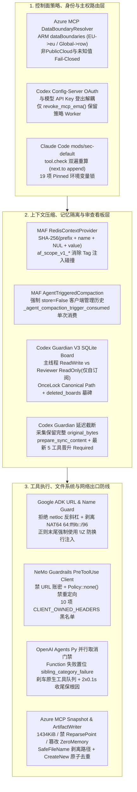

# Agent 主权数据边界、Guardian V3 只读消息板与 URL/NAT64 防 SSRF 验收实验室（2026-10-29）

**2026-10-29 范围与执行声明：本目录中的 Python 3.11+ 标准库参考契约（[`harness_contracts.py`](harness_contracts.py)）与 24 项单元测试 / 6 项单点变异校准套件（[`test_harness_contracts.py`](test_harness_contracts.py)）已在无网络本地环境通过正常模式（`python3 -B`）与优化模式（`python3 -B -O`）实际执行，24/24 基线测试 PASS、6/6 单点变异 KILLED（详见 [`run-summary.json`](run-summary.json)）。各上游产品宿主运行时（Azure MCP Server `4.0.0-beta.3`、Microsoft Agent Framework Python、Google ADK Python、NVIDIA NeMo Guardrails Rust Relay Plugin、OpenAI Agents Python SDK、OpenAI Codex CLI/App-Server、Anthropic Claude Code CLI、Planning with Files Hooks）在本实验室内均为 `NOT_RUN`（仅基于 [`fixtures/provenance.json`](fixtures/provenance.json) 所列 15 项 2026-10-29 实测 HTTP 200 的固定 40 位 SHA 源码补丁与原始文件进行静态审查与契约建模）。**

---

## 1. 为什么重要：跨三支柱的 6 条纵深防线

企业级 Agent 系统在走向多租户生产环境时，最容易在以下 6 个边界发生静默穿透或状态污染：

1. **云主权数据边界与工作区落盘边界（Microsoft Azure MCP Server `4.0.0-beta.3`）**：
   - `DataBoundaryResolver`（[`b3f862be67cfd39ff43a9de038bc747e378f4571`](https://github.com/microsoft/mcp/commit/b3f862be67cfd39ff43a9de038bc747e378f4571.patch)）在调用 ResiliencyAgent A2A 服务前，先由 `ResiliencyAgentCloudSupport.EnsureSupported` 拦截非 `AzurePublicCloud`（如主权云 `AzureChinaCloud` / `AzureUSGovernment`），再查询 ARM `providers/Microsoft.Resources/dataBoundaries/default?api-version=2024-08-01`。仅将 `"EU"` 映射为 `"eu"`、`"GLOBAL"` 映射为 `"row"` 并缓存于 stdio 进程生命周期内；仅对 `408/429/500/502/503/504` 执行最多 3 次二次方退避重试（`250 * attempt^2 ms`），任何未知值（如 `"USGov"`）、畸形 JSON 或非瞬态错误立即 **Fail-Closed** 终止，严禁无权威数据边界的 A2A 请求发出。
   - `LocalFileSnapshotter` 与 `AttachmentPolicy` 强制执行单请求最多 `10` 个文件、单文件上限 `1434 * 1024` 字节（`1,468,416` B）、15 种白名单扩展名，拒绝 URL、通配符、`~`、环境变量展开、UNC/网络盘、Windows 保留设备名（`CON`/`PRN`/`NUL`/`COM1..9`/`LPT1..9`）、NTFS 备用数据流（ADS）与符号链接/重解析点（`FileAttributes.ReparsePoint`）；读取后再次校验句柄长度、探测多出字节与 `LastWriteTimeUtc`，发现并发篡改立即调用 `CryptographicOperations.ZeroMemory(content)` 擦除内存并抛异常。
   - `ArtifactWriter` 对远端 Agent 返回的不可信文件名剥离全部路径前缀、过滤非法字符、按格式补齐扩展名（`.bicep`/`.json`/`.tf`/`.md`），并以 `FileMode.CreateNew` 原子递增 `-2`, `-3` 后缀写入 `azure-resiliency/` 子目录，杜绝 `../../.ssh/authorized_keys` 路径穿越与覆盖已有文件。
   - `IngestionLogDataValidator`（[`cd2556e5c60426660b55b09ac6cdf44ed559bdd9`](https://github.com/microsoft/mcp/commit/cd2556e5c60426660b55b09ac6cdf44ed559bdd9.patch)）在向 Azure Monitor Logs Ingestion API 上传前，本地校验 `1 MiB` 请求体上限、非空 JSON 对象数组与可选 DCR 流列类型 Schema（最多汇总 50 条精确到行与列名的诊断）。
2. **多租户向量检索分隔符防碰撞与客户端历史自触发压缩（Microsoft Agent Framework Python）**：
   - `RedisContextProvider`（[`9b72ed4f96bca2be463468fadeeed28de07514c9`](https://github.com/microsoft/agent-framework/commit/9b72ed4f96bca2be463468fadeeed28de07514c9.patch)）解决 RediSearch Tag 默认 `,` 分隔符与大小写折叠导致的租户 ID 注入/拆词串台：对 `application_id`、`agent_id`、`user_id`、`thread_id`、`conversation_id` 五类作用域字段统一按 `SHA256("agent-framework:redis-context:v1:{name}\0{value}")`（内嵌 NUL `\x00` 域分隔）生成 64 位十六进制 Token 存入 `af_scope_v1_{name}`（`case_sensitive=True, separator="\x1f"`），且强制要求 `agent_id` / `user_id` / `application_id` 至少提供一项非空。
   - `AgentTriggeredCompactionStrategy` 与 `UnloadSkillsCompactionStrategy`（[`c2a8f91b3070596c30723f74f303a124332bbb77`](https://github.com/microsoft/agent-framework/commit/c2a8f91b3070596c30723f74f303a124332bbb77.patch)）允许 Agent 在工具循环内主动调用 `compact_context` 或 `unload_skill`：在 `_prepare_messages_for_model_call` 中强制 `requires_client_managed_history=True`（若 `store=True` 或携带服务端托管 `conversation_id` 立即抛 `ChatClientInvalidRequestException`）；在完成的触发调用实例上打标 `_agent_compaction_trigger_consumed=True`（保证单策略实例跨并发会话无状态共享），若底层压缩抛异常则通过 `_restore_hidden_messages` 原位恢复隐藏的消息组。
3. **URL 解析器差分（Authority 反斜杠）、NAT64 内嵌私网剥离与 `\Z` 尾部换行注入防御（Google ADK Python）**：
   - `_url_validator.py`（[`4d0cd985faedb3c0d9e3579077de327a6ef86a52`](https://github.com/google/adk-python/commit/4d0cd985faedb3c0d9e3579077de327a6ef86a52.patch)）修复 `urllib.parse.urlparse` 与 `urllib3`/浏览器对 `http://169.254.169.254\@example.com/` 的解析器差分：显式拦截 `if '\\' in parsed_url.netloc`；针对 Python `IPv6Address.is_global` 将 NAT64 `64:ff9b::/96` 视为公网地址的盲区，通过 `_embedded_ipv4` 依次剥离 `ipv4_mapped`、`sixtofour`、`64:ff9b::/96` 低 32 位及高 96 位全零兼容地址，再二次判定 `not embedded.is_global`。
   - `skills/models.py`（[`e2e9336a7fde1ea6450a56629090be7bc06cae52`](https://github.com/google/adk-python/commit/e2e9336a7fde1ea6450a56629090be7bc06cae52.patch)）将 Skill/Agent 标识符正则末尾从 `$` 全面替换为 `\Z`，阻断 `skill-name\n` 尾部单换行绕过。
4. **远程护栏客户端防凭据泄露与并行原生工具失败即时刹车（NVIDIA NeMo Guardrails & OpenAI Agents Python SDK）**：
   - `nemo-guardrails-relay-plugin`（[`7d2ef097f11b98aedaab6261060d007c59b53329`](https://github.com/NVIDIA-NeMo/Guardrails/commit/7d2ef097f11b98aedaab6261060d007c59b53329.patch)）在 Rust PreToolUse 客户端中禁止 URL 内嵌用户名/密码、禁用 HTTP 重定向（`Policy::none()`）、维护 10 项 `CLIENT_OWNED_HEADERS` 协议头黑名单、校验失败不回显 Header 原文，并在超时（默认 `25,000 ms`）或错误时剥离 `tool_input` 执行 Fail-Closed 拦截。
   - `openai-agents-python`（[`cd26bbbc52847845fde73b9952b51e62e2bcbdc0`](https://github.com/openai/openai-agents-python/commit/cd26bbbc52847845fde73b9952b51e62e2bcbdc0.patch)）在 Function Tool 报错时立即置位 `sibling_category_failure` 停止排队中的 `shell`/`computer`/`apply_patch` 原生工具队列，提供 `2 * 0.1s` 双阶段有界收尾窗口，并抑制清理期次生异常以确保向上抛出原始 Function Tool 根因异常。
5. **Guardian V3 本地 SQLite 读写分离看板、延迟截断与企业 Config-Server 凭据解耦（OpenAI Codex）**：
   - `guardian-v3` 与 `message-board`（[`bca6cff1e140c1791975f0f6c47cb3add4f31710`](https://github.com/openai/codex/commit/bca6cff1e140c1791975f0f6c47cb3add4f31710.patch)）使用独立命名空间 `message_board_guardian_1.sqlite` 绑定主线程 `root: SessionId`；通过 `OnceLock<PathBuf>` 锁死首次 `canonicalize` 后的数据库路径防 symlink 漂移；主线程持 `Access::ReadWrite`，Guardian Reviewer 持 `Access::ReadOnly`（仅允许 `target_agent == caller` 的自订阅管理，禁止发帖/建频道/改他人订阅）；销毁时写入 `deleted_boards` Tombstone 防悬挂写复活。
   - `guardian-context`（[`83a9600acbc902ab8b212ab2e5166d7d55a2519d`](https://github.com/openai/codex/commit/83a9600acbc902ab8b212ab2e5166d7d55a2519d.patch)）在采集期无损保留 `NodeReplToolOutput` 等条目的完整 `original_bytes`，待游标切片后再于 `prepare_sync_content` 按模型预算延迟截断，并将最新 `MIN_RECENT_TOOL_ENTRIES = 5` 条工具证据晋升为 `Retention::Required`。
   - `config_manager.rs`（[`ec513795a6a727b32f906a2aa27f7fc92a996b6f`](https://github.com/openai/codex/commit/ec513795a6a727b32f906a2aa27f7fc92a996b6f.patch)）将企业 Config-Server OAuth 会话与模型推理凭据解耦：切换/登出 API Key 或 ChatGPT 账号时仅调用 `revoke_mcp_ema()`，保持企业策略 Bundle 与后台刷新 Worker 存活；`code_mode_host.rs`（[`5fdb50af9518cf39c134e3df0bdfec2be8f09b42`](https://github.com/openai/codex/commit/5fdb50af9518cf39c134e3df0bdfec2be8f09b42.patch)）将死亡 Code-Mode Host gRPC 子进程的替换严格限制在 `OpenSession` 准入阶段，防止中途静默重连重放外部副作用。
6. **组织级安全模块双遍防篡改、19 项 Pinned 环境变量锁与子 Agent Hook 隔离（Anthropic Claude Code & 社区纵深防御）**：
   - `mods/sec-default`（[`a5b0f2e03aba37ea34e527fe30b2f6aaa4895b9f`](https://raw.githubusercontent.com/anthropics/claude-code/a5b0f2e03aba37ea34e527fe30b2f6aaa4895b9f/mods/sec-default/hooks/register.ts)）在 `tool.check` 中执行双遍检查：当检测到 `user` 层插件篡改裁决或改写原因时，调用 `next.to(e, 'append')` 重算组织级纯净裁决 `held`，若 `held` 为 `deny`、受保护来源或 `ask (approver='host')` 且被放宽/改写，立即强制恢复 `held`；同时拦截对 19 个 Pinned 安全环境变量（9 个策略/OAuth 源变量 + 10 个动态库/Shell 启动变量如 `LD_PRELOAD`/`BASH_ENV`/`ZDOTDIR`/`NODE_OPTIONS`）的 `env.set` 调用，策略读取失败时 Fail-Closed。
   - `CHANGELOG.md`（[`0e1f4789406477380b267a01f3ddd50b0211e5b3`](https://raw.githubusercontent.com/anthropics/claude-code/0e1f4789406477380b267a01f3ddd50b0211e5b3/CHANGELOG.md)，`v2.1.309`–`v2.1.312`）修复沙箱外执行 shell rc/profile、`denyWrite` symlink 真实路径绕过与 `--mcp-config` 篡改漏洞，在 Bedrock/Vertex/Foundry 及禁用遥测环境下启用 `Monitor` 并拦截长耗时前台 `sleep`，且在 `v2.1.312` 正式停止发送 `claude_code.safety_event` OTel 事件。
   - `OthmanAdi/planning-with-files` `v3.26.0`（[`5d29800bf8b919ca9a88ee7885b90050b5cb64ed`](https://raw.githubusercontent.com/OthmanAdi/planning-with-files/5d29800bf8b919ca9a88ee7885b90050b5cb64ed/scripts/inject-plan.py)）通过绝对路径 `python -I -B` 防工作区模块劫持、逐级 `O_NOFOLLOW` `dir_fd` 快照防 symlink TOCTOU，并在 `hook_is_main` 中对含 `agent_id` 的子 Agent 或畸形元数据执行 Fail-Closed 跳过。

---

## 2. 架构边界与纵深防御全景图



---

## 3. 12 张 POC 验收卡（全部上游宿主运行时状态：`NOT_RUN`，本地参考契约状态：`PASS`）

| 卡号 | 目标机制与固定源码修订 | 前置条件 (Precondition) | 激励 / 故障注入 (Stimulus) | 期望结果 (Expected) | 独立负例控制 (Negative Control) | 本地契约测试与观测状态 |
| :--- | :--- | :--- | :--- | :--- | :--- | :--- |
| **G01** | Azure MCP `DataBoundaryResolver`<br/>(`microsoft/mcp@b3f862be`) | `cloud_type="AzurePublicCloud"`；配置伪造 ARM 响应序列 | 首请求返回 `503`，次请求返回 `200 {"properties":{"dataBoundary":"EU"}}`；随后再次调用 `resolve()` | 首次重试后返回 `"eu"` 并缓存（`arm_calls == 2`）；二次调用直接命中缓存不发 HTTP | 注入 `cloud_type="AzureChinaCloud"`、状态码 `403` 或 `dataBoundary="USGov"` 均不重试并立即抛 `ContractViolationError` | `test_01` / `test_02` **PASS**（Mutant `M1` KILLED）；`.NET Host NOT_RUN` |
| **G02** | Azure MCP `LocalFileSnapshotter` & `ArtifactWriter`<br/>(`microsoft/mcp@b3f862be`) | 本地工作区含 `.bicep` 候选文件；输出目录为 `azure-resiliency/` | 传入 `../../.ssh/my  resiliency\tplan.txt` (`format="bicep"`) 及同名冲突产物；向快照器注入 `is_reparse_point=True` 或读取中 `mtime` 变化 | 文件名被净化为 `my-resiliency-plan.bicep` 与 `my-resiliency-plan-2.bicep`；重解析点、`>1434KiB`、`CON.bicep` 与读取期篡改全部拒绝 | 若跳过 `lastSeparator` 截断或忽略读取后 `mtime`/长度二次比对，则触发路径逃逸或 TOCTOU 脏读失败 | `test_03` / `test_04` **PASS**；`.NET Host NOT_RUN` |
| **G03** | MAF Python `RedisContextProvider` NUL 域分隔<br/>(`microsoft/agent-framework@9b72ed4f`) | 初始化 `RedisContextProvider` 作用域计算器，`version=1` | 对 `("user_id", "alice,admin")`、`"alice"` 与 `("agent_id", "alice,admin")` 计算 `_scope_token` | 生成精确等于 `SHA256("agent-framework:redis-context:v1:user_id\0alice,admin")` 的 64 位十六进制摘要，含 `,` 的租户值绝不拆裂 Tag | 若移除 `\x00` 改为普通分隔符或省略 principal 过滤字段（`agent_id/user_id/application_id` 全空），立即被断言捕获或抛异常 | `test_05` / `test_06` **PASS**（Mutant `M2` KILLED）；`Redis Server NOT_RUN` |
| **G04** | MAF Python `AgentTriggeredCompactionStrategy`<br/>(`microsoft/agent-framework@c2a8f91b`) | 会话最新消息组包含已完成的 `compact_context` 工具调用 | 分别在 `store=True`、远端 `conversation_id`、`store=False`（内部策略抛异常 vs 成功）下执行预备钩子 | 服务端存储或远端会话下立即拒绝；策略异常时完整恢复隐藏组且不标已消费；成功时打标 `_agent_compaction_trigger_consumed=True` 且二次调用幂等跳过 | 若在 `store=True` 下放行本地压缩，会导致本地摘要与远端存储的未压缩历史重复叠加 | `test_07` / `test_08` **PASS**；`MAF Runtime NOT_RUN` |
| **G05** | Google ADK `_url_validator.py` 反斜杠与 NAT64 防护<br/>(`google/adk-python@4d0cd985`) | 工具接收模型生成的目标 URL 及 DNS 解析出的 IP 列表 | 输入 `http://169.254.169.254\@example.com/` 或解析出 NAT64 `64:ff9b::a9fe:a9fe`、`2002:0a00:0001::1`、`::ffff:127.0.0.1` | 全部抛出 `ContractViolationError` 拦截，不发起底层 Socket 连接 | 若仅依赖 `urllib.parse.urlparse().hostname` 与 `IPv6Address.is_global`，反斜杠 URL 与 NAT64 元数据地址均会漏检放行 | `test_09` / `test_10` **PASS**（Mutant `M3` KILLED）；`ADK Runtime NOT_RUN` |
| **G06** | Google ADK `\Z` 标识符锚点<br/>(`google/adk-python@e2e9336a`) | 校验 `SKILL.md` Frontmatter `name` 字段 | 输入合法 `"azure-architecture-review"` 与带尾部换行的 `"azure-architecture-review\n"` | 合法 kebab-case 通过；带尾部 `\n` 的名称被 `\Z` 严格拒绝 | 若使用 `^[a-z0-9]+(-[a-z0-9]+)*$`，Python `re.match` 会放行末尾带 `\n` 的污染标识符 | `test_11` **PASS**；`ADK Runtime NOT_RUN` |
| **G07** | NVIDIA NeMo Guardrails Rust `PreToolUse` 客户端<br/>(`NVIDIA-NeMo/Guardrails@7d2ef097`) | 配置 Relay Hook 端点与自定义鉴权 Headers | 传入带 `user:pass@` 的 URL、覆盖 `Transfer-Encoding` 或含 `\n` 的坏 Header 值 | 全部抛出 `ContractViolationError`，且报错文本对坏 Header 值强制脱敏（`value redacted`），合法端点补齐 `/v1/hooks/nemo-relay` | 若允许覆盖 `CLIENT_OWNED_HEADERS` 或在日志回显 Header 原文，将引发请求走私或密钥泄漏 | `test_12` **PASS**（Mutant `M4` KILLED）；`Rust Relay NOT_RUN` |
| **G08** | OpenAI Agents Python 并行原生工具刹车<br/>(`openai/openai-agents-python@cd26bbbc`) | 同轮包含 Function Tools 与排队中的 `shell`/`apply_patch` 原生工具 | 第二个 Function Tool 返回 `ERROR:policy_violation`，且取消清理触发次生异常 | 立即置位 `sibling_category_failure` 阻断原生工具队列执行，预留 `0.2s` 双阶段收尾窗口，向上抛出原始 `ERROR:policy_violation` | 若将清理期 `CancelledError` 或次生异常直接抛出，会吞掉 Function Tool 的真实失败根因 | `test_13` **PASS**；`Agents SDK Runtime NOT_RUN` |
| **G09** | Codex Guardian V3 本地 SQLite 消息板<br/>(`openai/codex@bca6cff1`) | 绑定主线程 `root_session_id` 打开 `message_board_guardian_1.sqlite` | Reviewer 以 `ReadOnly` 连接调用自订阅、修改 `main` 订阅、发帖；随后切换 canonical 路径或执行 `delete_board` 后再写 | Reviewer 自订阅成功，改他人订阅與发帖均报 `PermissionDenied`；路径漂移与 Tombstone 删除后写入全部被拦截 | 若对 `ReadOnly` 一刀切禁止所有订阅或忽略 `deleted_boards` 检查，将破坏 Reviewer 监听或导致已销毁会话复活 | `test_14` / `test_15` / `test_24` **PASS**；`Codex CLI NOT_RUN` |
| **G10** | Codex Guardian 延迟截断与尾部工具强保留<br/>(`openai/codex@83a9600a`) | 采集 1 条 `User`、5 条 `ToolOutput` 与 1 条 600B `NodeReplToolOutput` | 执行 `prepare_guardian_sync_transcript`（`tool_byte_limit=200`, `node_repl_byte_limit=150`） | 采集期 `original_bytes == 600` 完整保留；准备期截断至 `150`B 并标记 `truncated=True`；最新 5 条工具证据全部晋升为 `Required`，最老的第 1 条工具为 `Optional` | 若采集期提前截断或未将最新 5 条工具晋升为 `Required`，增量切片与预算收缩时会丢失关键近期工具证据 | `test_16` **PASS**（Mutant `M5` KILLED）；`Codex CLI NOT_RUN` |
| **G11** | Codex Config-Server 解耦与 Code-Mode Host 准入替换<br/>(`openai/codex@ec513795` & `5fdb50af`) | `config_server_enabled=True`；Code-Mode gRPC Host 子进程中途退出 | 触发模型 API Key 登出/切换；随后分别在 `ExecuteTurn` 与 `OpenSession` 阶段派发 Code-Mode RPC | 登出模型账号仅撤销 `mcp_ema_token_cached`，企业策略 Bundle 与刷新 Worker 保持存活；`ExecuteTurn` 拒绝重启已死 Host 报 `Unavailable`，仅 `OpenSession` 允许替换 | 若登出模型账号时一并清空 `cloud_config_bundle` 或在 Turn 中途静默重启 gRPC Host，会导致治理策略失效或外部副作用被重放 | `test_17` **PASS**；`Codex App-Server NOT_RUN` |
| **G12** | Claude Code `mods/sec-default` 双遍裁决与 PWF 子代理门禁<br/>(`anthropics/claude-code@a5b0f2e0` & `planning-with-files@5d29800b`) | 组织 `append` 层返回受保护 `deny`，用户层 Mod 将其改写为 `allow` 或篡改原因；Hook 接收含 `agent_id` 的 JSON | 运行 `evaluate_claude_sec_default_two_pass`、`check_claude_sec_default_env_set("BASH_ENV")` 与 `evaluate_pwf_subagent_hook_gate` | 触发第二遍 `append` 重算并强制恢复组织级 `deny` 与原原因（用户层收紧 `ask->deny` 则保留）；19 项 Pinned 变量及策略读取失败一律拒绝；子 Agent 与畸形 JSON 全部 Fail-Closed 返回 `skip` | 若移除 `BASH_ENV` 锁定或仅做单遍检查，用户层 Mod 可通过环境变量注入命令或冲掉组织 `deny` 规则 | `test_18` / `test_19` / `test_20` **PASS**（Mutant `M6` KILLED）；`Claude CLI NOT_RUN` |

---

## 4. 可直接复制的 `[→harness]` 工程落地清单

1. **`[→harness]` URL 与网络出口校验器升级（防解析器差分与 NAT64 SSRF）**：
   - 在所有工具层 URL 预检器中加入 `if "\\" in urllib.parse.urlparse(url).netloc: raise ValueError(...)`；
   - 在 IP 全局性检查中不能只调 `ip.is_global`，必须显式剥离 `ipv4_mapped`、`sixtofour` 与 `ipaddress.ip_network("64:ff9b::/96")`（取低 32 位转 `IPv4Address`）后再检查 `is_global`。
2. **`[→harness]` Python 标识符正则锚点统一替换为 `\Z`**：
   - 扫描仓库内所有校验 `skill_name`、`agent_name`、`tool_name`、`namespace` 的正则表达式，将末尾 `$` 替换为 `\Z`，消除尾部换行符 `\n` 注入。
3. **`[→harness]` 多租户向量/缓存索引的 NUL 域分隔 Token 化**：
   - 当底层检索引擎（如 RediSearch Tag、逗号分隔元数据过滤器）存在分隔符注入或大小写折叠风险时，使用 `hashlib.sha256(f"{domain}:v1:{field_name}\x00{raw_value}".encode("utf-8")).hexdigest()` 生成定长十六进制作用域 Token。
4. **`[→harness]` 主线程与安全审查子代理（Guardian/Reviewer）的本地存储权限分离**：
   - 审查子代理仅授予 `ReadOnly` 连接句柄（仅放行其对自身 `caller_agent` 的订阅管理），并通过 `OnceLock` 绑定首次 `canonicalize` 的 SQLite 路径与 `deleted_boards` 墓碑表。

---

## 5. 本地复现命令与文件哈希清单

在任意安装有 Python 3.11+ 的无网络环境中，进入本目录执行：

```bash
python3 -B -m unittest discover -s . -p 'test_harness_contracts.py' -v
python3 -B -O -m unittest discover -s . -p 'test_harness_contracts.py' -v
sha256sum -c SHA256SUMS
```

### 配套文件与溯源引用

- 标准库契约实现：[`harness_contracts.py`](harness_contracts.py) (`6a9868b45b865f3811bd2fce52937b8aa8193719231d79291e37d3a2b8fd9b57`)
- 24 项单测与 6 项变异校准套件：[`test_harness_contracts.py`](test_harness_contracts.py) (`4958bc5a0f88465d798a11b3bc3925f144bca3954af391301f2b68eacd5f72c0`)
- 15 项固定源码补丁与原始文件溯源清单：[`fixtures/provenance.json`](fixtures/provenance.json) (`62d11759b4cfac0a7bcacd9cb9392cfafc2c894d084aa07a57c3642377625739`)
- 离线执行与变异校准摘要：[`run-summary.json`](run-summary.json) (`c4b4fb850f84fe7b92af5d09add83df6f49ad924965396772fe63dfe79092794`)
- 校验和清单：[`SHA256SUMS`](SHA256SUMS)
