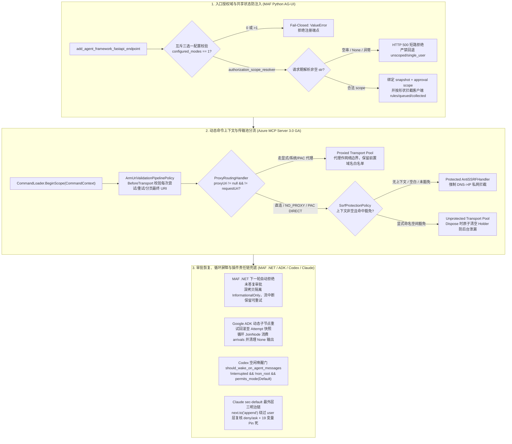

# Agent 授权域、双重派发护栏与异步唤醒验收实验室（2026-10-19）

**2026-10-19 范围与执行声明：本包中的 Python 3.11+ 标准库参考契约（`harness_contracts.py`）与测试套件（`test_harness_contracts.py`）已在本地无网络正常模式（`python3 -B`）与优化模式（`python3 -B -O`）下实际执行，22/22 基线测试 PASS、6/6 定向单点 mutation KILLED；各上游产品运行时（MAF FastAPI/.NET 宿主、Azure MCP Server 二进制、Google ADK 运行时、OpenAI Codex CLI、Anthropic Claude Code CLI）均为 `NOT_RUN`（仅固定 SHA 源码/diff 静态审阅）。**

本资产将三支柱 6 组核心控制面机制收敛为一套可复演的无模型离线参考契约、12 张 POC 验收卡、架构边界图与选型问答，用于解决方案架构师（SA）在技术答疑、POC 准入验收和架构评审中快速检验“授权域隔离、审批状态防篡改、动态上下文 SSRF 边界、循环工作流屏障、异步子代理唤醒与插件责任链兜底”。

## 1. 包内配套文件与叶文件哈希

- [参考契约实现 `harness_contracts.py`](harness_contracts.py)
- [22 项单测与 6 项变异校准 `test_harness_contracts.py`](test_harness_contracts.py)
- [固定源码溯源清单 `fixtures/provenance.json`](fixtures/provenance.json)
- [离线执行摘要 `run-summary.json`](run-summary.json)
- [包内 SHA256 清单 `SHA256SUMS`](SHA256SUMS)

当前已锁定叶文件 SHA-256（先固定叶文件，再固定本文，最后生成覆盖本包 5 个文件的 `SHA256SUMS`，避免自引用）：

```text
2982e3d9b3c4b7b31077495020c775154c99870bae79de36092ccd454b2a99dc  harness_contracts.py
794a54edf4765a5748757c93767f0485f48eab910416ed3492f690b287eed3d8  test_harness_contracts.py
8e98827e7a165c24d3d3e5c5f510a6b1cb8d7c09766866dbc877bde5e559a07e  fixtures/provenance.json
7c021b7ccd6e721cbd3b6d913955cd7db3ddaf4214c1aa75382dde210043cfd6  run-summary.json
```

---

## 2. 固定源码证据与版本/运行边界表

| 来源 ID | 支柱与仓库 | 固定 Revision / Tag | 核心审阅路径 | 证据层级与运行边界 |
| :--- | :--- | :--- | :--- | :--- |
| `S01_MAF_AGUI_AUTH_SCOPE` | 微软 `microsoft/agent-framework` | `9a1d66b3e973bdbfdcd4359d72c5f6fd4ff4d931` | `python/packages/ag-ui/agent_framework_ag_ui/_endpoint.py` | 固定 commit `.diff`（HTTP 200）；提交于 `python-1.22.0` 之后，尚未打入 PyPI release tag；FastAPI 实机 `NOT_RUN` |
| `S02_MAF_AGUI_APPROVAL_SHAPE` | 微软 `microsoft/agent-framework` | `abeed6c62a8cc70e796334a5b490c8e94621f89d` | `python/packages/ag-ui/agent_framework_ag_ui/_agent_run.py` | 固定 commit `.diff`（HTTP 200）；已进入 `python-1.22.0` tag；FastAPI 实机 `NOT_RUN` |
| `S03_AZURE_MCP_ARM_SSRF_POLICY` | 微软 `microsoft/mcp` | `da75e4d390cd8be7e77119dfd4d6c0e47188eeb9` | `core/Microsoft.Mcp.Core/src/Helpers/SsrfProtectionPolicy.cs`、`ArmUriValidationPipelinePolicy.cs` | 固定源码与 `.diff`（HTTP 200）；已进入 `Azure.Mcp.Server-3.0.0` GA；.NET 运行时 `NOT_RUN` |
| `S04_MAF_DOTNET_AUTO_REJECT_APPROVAL` | 微软 `microsoft/agent-framework` | `95feea605dbbe879f678602585c76fdb5a963b63` | `docs/decisions/0045-dotnet-unanswered-tool-approvals.md`、`ApprovalResponseBindingChatClient.cs` | 固定 ADR 与 `.diff`（HTTP 200）；已进入 `dotnet-1.25.0` tag；.NET 运行时 `NOT_RUN` |
| `S05_GOOGLE_ADK_DYNAMIC_CHILD_RETRY` | AI Labs `google/adk-python` | `e2dbc0f55027372f3a701d41004ee006ee8f9f14` | `src/google/adk/workflow/_dynamic_node_scheduler.py`、`_node_runner.py` | 固定 commit `.diff`（HTTP 200）；PyPI 正式包归属未核；ADK 运行时 `NOT_RUN` |
| `S06_GOOGLE_ADK_LOOP_JOIN_BARRIER` | AI Labs `google/adk-python` | `a6ed85905d4c1d1f285ba9d4f76a9d801b66d17f` | `src/google/adk/workflow/_workflow.py`、`docs/guides/workflow/join_node/index.md` | 固定 commit `.diff`（HTTP 200）；PyPI 正式包归属未核；ADK 运行时 `NOT_RUN` |
| `S07_CODEX_IDLE_WAKE_ON_AGENT_MESSAGES` | Coding CLI `openai/codex` | `8c076942cb70fba8e5c4732c23f1faabc4aed484` | `codex-rs/core/src/session/turn_input.rs`、`handlers.rs`、`tasks/mod.rs` | 固定 commit `.diff`（HTTP 200）；`Stage::UnderDevelopment` 默认 `false`，晚于 `rust-v0.163.0`；Codex CLI `NOT_RUN` |
| `S08_COOKBOOK_HARNESS_AWARE_PLUGIN_EVALS` | Coding CLI / Eval `openai/openai-cookbook` | `5bd6cb40b6b84b69b2032d810610aa85064102df` | `examples/partners/harness_aware_plugin_evals/eval_grading.py`、`assert_codex_result.py` | 固定源码与 `.diff`（HTTP 200）；Promptfoo / Codex SDK 实机 `NOT_RUN` |
| `S09_CLAUDE_SEC_DEFAULT_REGISTER` | Coding CLI `anthropics/claude-code` | `dd6bee38458cc3e6dc5f2b16eca1f0f364619ad8` | `mods/sec-default/hooks/register.ts`、`mods/sec-default/README.md` | 固定源码（HTTP 200）；对应 `v2.1.295`–`v2.1.302` 演进；Claude Code CLI `NOT_RUN` |

---

## 3. 核心架构边界图（Mermaid）



---

## 4. 六大机制深度拆解与 SA 客户问答速查

### 4.1 MAF Python AG-UI：显式授权域三选一与客户端 Shared State 按形状防提权
- **源码机制（`S01` / `S02`）**：
  1. `_validate_authorization_scope_configuration` 要求 `authorization_scope_resolver`、`snapshot_scope_resolver`、`single_user=True` 必须且只能启用一个（`configured_modes == 1`），且 `single_user` 必须是严格 `bool`。
  2. FastAPI 的 `dependencies=[Depends(...)]` 仅用于认证拦门，其返回值**不建立**会话或审批状态隔离域；若 `authorization_scope_resolver` 返回空字符串或非字符串，在访问任何 snapshot/approval state 之前抛 HTTP 500，绝不降级为 unscoped。
  3. 当自定义 Wrapper Agent 隐藏了内部 `ToolApprovalMiddleware` 的 `source_id` 时，`_carries_tool_approval_authority` 按数据结构形状（字典含非空列表 `rules`、`queued_approval_requests` 或 `collected_approval_responses`）拦截客户端 `state` 注入，同时 `_tool_approval_state_keys` 保护服务端已存审批状态不被空列表覆盖。
- **SA 问答落点**：客户升级 MAF Python 后若报 `ValueError: AG-UI endpoint authorization must be explicit`，切勿在多租户生产环境盲加 `single_user=True`（会导致跨用户共享同一进程级随机 scope 且进程重启后丢失持久化归属），必须接入基于 JWT/Entra ID Principal 的 `authorization_scope_resolver`。

### 4.2 Azure MCP Server 3.0 GA：移除静态全局变量、引入 `CommandContextAccessor` 与双轨代理分流
- **源码机制（`S03`）**：
  1. 废除旧版静态 `EndpointValidator.SetDangerouslyDisabledSsrfProtectionNamespaces`，改为 Host 级不可变 `SsrfProtectionPolicy`（`OrdinalIgnoreCase`、不 trim，故 `" ALL "` 不会误触发全量豁免）。
  2. `CommandContextAccessor` 在 `EndScope` 时调用 `holder.Clear()` 清空已捕获引用，阻断后台逃逸 Task 继承已结束命令的豁免权；且禁止嵌套 Scope。无上下文或空白命名空间下，即使配置了 `AllNamespaces = "ALL"` 也无条件保持 SSRF 保护开启。
  3. 共享 `ArmClient` 在 `HttpPipelinePosition.BeforeTransport` 注入 `ArmUriValidationPipelinePolicy`，对每次重试、分页 `nextLink`、LRO 轮询的最终 URI 执行校验；`ProxyRoutingHandler` 区分真实代理与 `NO_PROXY`/PAC `DIRECT`，后者強制进入 `AntiSSRFHandler` 做 DNS->IP 私网拦截。
- **SA 问答落点**：企业内网同时存在正向代理与 `NO_PROXY` 私网绕过规则时，代理路由不等于端点授权；工具层域名白名单在代理改写前始终生效，而直连分支仍受发送时 DNS->IP 保护。

### 4.3 MAF .NET：未响应工具审批在下一轮自动拒绝与工作流完成后转发（ADR 0045）
- **源码机制（`S04`）**：
  1. `ApprovalResponseBindingChatClient` 在新的一轮运行中先绑定已提供的回答，再对剩余无结果的未决请求自动生成 `approved: false` 拒绝，使丢失前端弹窗的会话可恢复对话。
  2. 下游 `FunctionInvokingChatClient` (FICC) 会原地将处理过的调用标记为 `InformationalOnly = true`；因此必须通过 `SnapshotRequest` 深拷贝分离返回给调用方的对象与传给 FICC 的对象，且仅在内部调用成功后才清除 Session 中的未决状态。
  3. 多 Agent 工作流 `AIAgentHostExecutor` 扣留外部审批回答，直到当前 Agent 同时产出匹配的 `FunctionCallContent` 与 `FunctionResultContent` 后才转发，防止其他共享历史的 Agent 重复执行工具。

### 4.4 Google ADK：动态子节点重试回滚至 Attempt 快照与循环 `JoinNode` 迭代屏障
- **源码机制（`S05` / `S06`）**：
  1. 动态子节点调度器在每次父节点 Attempt 启动时记录 `snapshot_counters(parent_path)`；重试时仅回滚到本次失败 Attempt 起点，防止把更早已被父节点业务校验拒绝的子节点结果从缓存中错误重放（replay）。
  2. 循环中的 `JoinNode` 通过 `join_arrivals` 集合追踪自上次触发以来完成的前驱节点，全部到达才触发并立即 `pop` 消费；当前驱重跑返回 `None` 时显式清除旧输出，避免跨迭代拼装脏数据。

### 4.5 OpenAI Codex 空闲会话唤醒三道边界与 Cookbook Harness-Aware 插件评测
- **源码机制（`S07` / `S08`）**：
  1. `[→harness]` Codex `should_wake_on_agent_messages` 对异步子 Agent 投递的 queue-only 邮件设置三道硬边界：`!is_interrupted()`（用户已按 Stop 则不唤醒）、`!is_non_root_agent()`（继承了配置的 SubAgent 自身不被唤醒）、`TurnStartKind::Automatic.permits_mode(mode)`（Root 处于 `Plan` 只读模式时不自动开启新 Turn）；唤醒后复用 `previous_options` 保持推理强度不漂移。
  2. `[→harness]` OpenAI Cookbook 证明插件在 Standalone Loop（5/5）与真实 Codex Harness（3/5）之间的差距源于系统提示词鸿沟：通过 MCP `initialize` 响应下发 `instructions` 字段即可在不改工具 Schema 的情况下修复模型跳步背诵序列号的问题，并用 `missing_tools`、`missing_series`、`unexpected_series` 三集合差集做确定性离线判分。

### 4.6 Anthropic Claude Code：`mods/sec-default` 双重派发防篡改与 19 个高危环境变量 Pin 死
- **源码机制（`S09`）**：
  1. `[→harness]` `cc-plugin-sec-default@builtin` 位于 `prepend` 最外层，对 `classic.*`、`prompt.*`、`skill.prompt`、`session.compact`、`settings.read` 直接调 `next.to(e, 'append')` 跳过整个 `user` 插件层。
  2. 在 `tool.check` 上执行双重派发（Two-Pass Verification）：若检测到 `user` 层插件改松了裁决（例如一键免确认插件将 `deny`/`ask` 改为 `allow`，或篡改了 `ask` 的归属原因），立即绕过 `user` 层重跑 `next.to(e, 'append')` 并恢复组织级 `deny`/受保护 `ask`（用户层收紧如 `ask -> deny` 则保留）。
  3. 在 `env.set` 上将 Managed Settings 变量、9 个策略/OAuth 路径变量及 10 个代码注入变量（`LD_PRELOAD`、`NODE_OPTIONS`、`BASH_ENV` 等）全部 Pin 死，且策略读取异常时 **fail-closed** 拒绝所有用户层环境变量写入。

---

## 5. 12 张可复用 POC 验收与回归卡（Expected vs Observed）

> **状态约定**：`Reference_Lab_Observed` 为本包 Python 3.11+ 标准库参考契约的实测结果；`Upstream_Host_Observed` 为对应上游产品宿主/CLI 的实测状态（当前全部为 `NOT_RUN`）。

| 卡号 | 目标机制与来源 ID | 前置条件 (Precondition) | 激励 / 故障注入 (Stimulus) | 期望结果 (Expected) | 独立负控 / 变异靶点 (Negative Control) | Reference_Lab_Observed | Upstream_Host_Observed |
| :--- | :--- | :--- | :--- | :--- | :--- | :--- | :--- |
| `C01` | MAF AG-UI 授权模式互斥 (`S01`) | 注册 AG-UI FastAPI 端点 | 未传任何模式，或同时传 `authorization_scope_resolver` 与 `single_user=True`，或传 `single_user="true"` | 立即抛 `ValueError` / `TypeError` 拒绝注册 | 移除模式计数或类型检查 | `PASS` (`test_01`–`test_03`) | `NOT_RUN` |
| `C02` | MAF AG-UI 解析失败禁回退 (`S01`) | 配置 `authorization_scope_resolver` | Resolver 返回 `""` 或 `None` | 抛 HTTP 500 错误，访问 snapshot/approval 前短路，不回退 single-user | 失败时回退至默认公共 scope | `PASS` (`test_04`, `test_05`) | `NOT_RUN` |
| `C03` | MAF AG-UI 审批状态形状防注入 (`S02`) | 外层 Wrapper 隐藏中间件 `source_id`，服务端存有 `ToolApprovalState` | 客户端 `state` 注入非空 `rules` / `queued_approval_requests` 或用空列表覆盖服务端已有键 | 非空审批列表按形状丢弃并告警；服务端已有键保持原值 | `M1_agui_skip_shape_guard`（跳过形状检测） | `PASS` / `M1 KILLED` (`test_06`, `test_07`) | `NOT_RUN` |
| `C04` | Azure MCP 无上下文与非 Trim 策略 (`S03`) | `SsrfProtectionPolicy([" ALL ", "compute"])` 或 `["ALL"]` | 在无 `CommandContext`、空白命名空间或 `"storage"` 命名空间下查询策略 | 无上下文/空白命名空间即使在 `"ALL"` 下仍返回 `True`（开启防护）；`" ALL "` 不匹配 `"ALL"` | `M2_mcp_blank_context_allows_all_override` | `PASS` / `M2 KILLED` (`test_08`, `test_09`) | `NOT_RUN` |
| `C05` | Azure MCP Scope 退出清空与代理分流 (`S03`) | 开启 `BeginScope("compute")`，后台协程捕获 Holder；或配置代理 / `NO_PROXY` | 尝试嵌套 `BeginScope`；调用 `Dispose()` 后后台协程读取；分别走代理与 PAC `DIRECT` | 嵌套抛异常；`Dispose()` 后捕获引用读到 `None`；无效端点先抛 `SecurityException`，PAC `DIRECT` 走受保护传输 | `Dispose` 不调用 `holder.Clear()` | `PASS` (`test_10`, `test_11`) | `NOT_RUN` |
| `C06` | MAF .NET 未答复审批自动拒绝与深拷贝 (`S04`) | 会话含未答复 `call-1`、已答复 `call-2`、已结算 `call-settled` | 发起下一轮运行；（a）内部调用成功；（b）内部调用中途失败 | 自动为 `call-1` 生成拒绝；FICC 副本置 `InformationalOnly=True` 但返回副本与失败残留请求保持 `False` | `M3_maf_dotnet_mutate_saved_request_in_place` | `PASS` / `M3 KILLED` (`test_12`, `test_13`) | `NOT_RUN` |
| `C07` | MAF .NET 工作流审批转发门槛 (`S04`) | 多 Agent 共享会话工作流开启消息转发 | 当前 Agent 仅产出 `FunctionCallContent` 但缺少匹配的 `FunctionResultContent` | 抛 `InvalidOperationException` 拒绝构造转发审批，防下游重复执行 | 允许仅凭请求详情无结果转发 | `PASS` (`test_14`) | `NOT_RUN` |
| `C08` | Google ADK 动态子节点重试快照回滚 (`S05`) | 父节点 Attempt 1 执行 `fetch` 拿到 `fetch_1` 后因父校验失败抛可重试异常 | Attempt 2 启动时记录快照，`fetch` 内部失败触发重试进入 Attempt 3 | Attempt 3 计数器回滚至 Attempt 2 起点（生成 `fetch_2` 重新执行），绝不重放被拒绝的 `fetch_1` | `M4_adk_rewind_counter_to_zero`（计数器全清零） | `PASS` / `M4 KILLED` (`test_15`) | `NOT_RUN` |
| `C09` | Google ADK 循环 `JoinNode` 屏障与空值清理 (`S06`) | `JoinNode` 位于 Loop 内，前驱为 `node_a` 与 `node_b` | 第 1 轮触发后进入第 2 轮，`node_a` 先完成且返回 `None`，`node_b` 尚未完成 | `node_a` 完成时不提前触发 Join；待 `node_b` 完成后输出 `{'node_a': None, 'node_b': 'B2'}` | 仅检查 `COMPLETED` 状态不消费 `arrivals` | `PASS` (`test_16`) | `NOT_RUN` |
| `C10` | Codex 空闲 Root 异步消息唤醒三边界 (`S07`) | 开启 `wake_on_agent_messages`，队列收到 `trigger_turn=false` 的子 Agent 邮件 | 分别测试：（a）正常空闲 Root；（b）已按 Stop 的 Root；（c）`Plan` 模式 Root；（d）继承配置的 `SubAgent` | 仅（a）唤醒且保留 `previous_options`；（b）（c）（d）均返回 `False` 不开启新 Turn | `M5_codex_wake_ignores_plan_and_subagent_guards` | `PASS` / `M5 KILLED` (`test_17`, `test_18`) | `NOT_RUN` |
| `C11` | Cookbook MCP `instructions` 与差集判分 (`S08`) | 对比无/有 MCP `initialize.instructions` 的 Codex 调用轨迹 | 轨迹 A 跳过 `resolve` 并多查记忆序列；轨迹 B 先 `resolve` 后精确查序列 | 判分器对轨迹 A 报 `missing tools` 与 `fetched series outside the expectation`；轨迹 B 得 `1.0` | 仅检查 `expected_series` 子集而不检查 `unexpected_series` | `PASS` (`test_19`) | `NOT_RUN` |
| `C12` | Claude `sec-default` 双重派发与环境变量 Pinning (`S09`) | `sec-default` 坐最外层，组织规则含 `deny` 或受保护 `ask`，19 个高危变量已固定 | 用户层 Mod 将 `deny` 改为 `allow`、篡改 `ask` 理由、或写 `LD_PRELOAD`（含策略读取失败场景） | 双重派发恢复组织 `deny`/`ask`（用户层 `ask->deny` 收紧则保留）；用户层写 Pin 变量及策略读取失败均 `deny_pinned` | `M6_claude_sec_default_fail_open_on_user_lift` | `PASS` / `M6 KILLED` (`test_20`–`test_22`) | `NOT_RUN` |

---

## 6. 离线复现命令（无需网络、无需模型密钥）

在包含本资产包的目录下直接运行标准库测试与变异校准：

```sh
python3 -B test_harness_contracts.py
python3 -B -O test_harness_contracts.py
```
