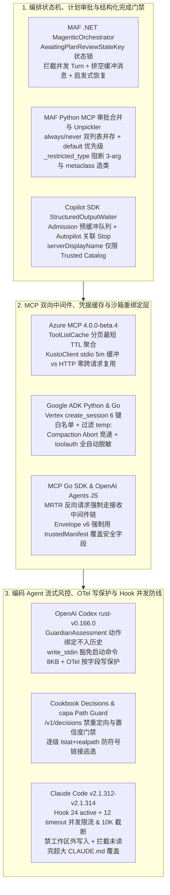

# Agent 计划审批保持、Autopilot 结构化输出与 Hook 并发限流验收实验室（2026-10-31）

**2026-10-31 范围与执行声明：本目录中的 Python 3.11+ 标准库参考契约（[`harness_contracts.py`](harness_contracts.py)）与 24 项单元测试 / 6 项单点变异校准套件（[`test_harness_contracts.py`](test_harness_contracts.py)）已在无网络本地环境通过正常模式（`python3 -B`）与优化模式（`python3 -B -O`）实际执行，24/24 基线测试 PASS、6/6 单点变异 KILLED（详见 [`run-summary.json`](run-summary.json)）。各上游产品宿主运行时（Microsoft Agent Framework `.NET 1.27.0` & Python `1.24.0`、GitHub Copilot SDK、Azure MCP Server `4.0.0-beta.4`、Google ADK Python & Go、MCP Go SDK、OpenAI Agents JS、OpenAI Codex `rust-v0.166.0`、OpenAI Cookbook Decisions API、Anthropic Claude Code `v2.1.312`–`v2.1.314`、`infragate/capa`）在本实验室内均为 `NOT_RUN`（仅基于 [`fixtures/provenance.json`](fixtures/provenance.json) 所列 20 项 2026-10-31 实测 HTTP 200 的固定 40 位 SHA 源码补丁与原始文件进行静态审查与契约建模）。**

---

## 1. 为什么重要：跨三支柱的 6 条纵深防线

企业级多智能体与编码 Agent 系统在落地 HITL 人工审批、长耗时 Autopilot 自治会话、MCP 双向通信与沙箱恢复时，极易在以下 6 个边界发生状态丢失、中间件旁路或权限提升：

1. **Magentic 计划审批状态保持、MCP 双审批列表合并与 Checkpoint 元类反序列化防线（Microsoft Agent Framework `.NET 1.27.0` & Python `1.24.0`）**：
   - `MagenticOrchestrator`（[`5f469d26d51977b396bbec9007a0052975ea723c`](https://github.com/microsoft/agent-framework/commit/5f469d26d51977b396bbec9007a0052975ea723c.patch)）新增 `AwaitingPlanReviewStateKey` 与私有状态位 `_isAwaitingPlanReview`。在 `SubmitPlanReviewRequestAsync` 发出人工审查请求时置 `true`；在等待期间若收到非预期的审批响应则抛出 `InvalidOperationException`，若收到并发普通对话 Turn 则在 `TakeTurnAsync` 发出 `WorkflowWarningEvent` 并忽略该 Turn，同时在 `ProcessTurnMessagesAsync` 排空伴随到达的缓冲普通消息，防止人类未批准计划前错误触发 Replan 或污染任务台账；仅当 `response.IsApproved == true` 时才清零 `_isAwaitingPlanReview` 并委派团队，Revise 分支保持等待；从旧版无 `AwaitingPlanReviewStateKey` 的 Checkpoint 恢复时，通过启发式条件（`requirePlanSignoff && TaskLedger != null && !IsTerminated && _currentSpeakerExecutorId == null`）向后兼容恢复等待态。
   - `agent_framework_foundry` 与 `agent_framework_openai`（[`2e931679dcf68b504f27fb0de266a543467deaaa`](https://github.com/microsoft/agent-framework/commit/2e931679dcf68b504f27fb0de266a543467deaaa.patch)）修复了当 `approval_mode` 字典同时包含 `always_require_approval` 与 `never_require_approval` 时，后执行的 `never_require_approval` 赋值直接覆盖 `mcp["require_approval"]` 导致高危工具强制审批列表被静默擦除的严重缺陷；`_mcp.py`（[`5de71b8a7a2cfaba3b27c4a38e458eb1c10c4406`](https://github.com/microsoft/agent-framework/commit/5de71b8a7a2cfaba3b27c4a38e458eb1c10c4406.patch)）进一步引入 `MCPSpecificApproval.default`（`"always_require"` | `"never_require"` | `None`），确立 `always_require_approval > never_require_approval > default` 严格判定序，将误传的裸字符串包装为单元素元组 `(names,)` 防止子串匹配绕过，并在仅配 `never_require_approval` 却未设 `default` 时抛出 `FutureWarning`。
   - `_checkpoint_encoding.py`（[`34452c8ae32b514d6d9be83359e1692bb5446ef2`](https://github.com/microsoft/agent-framework/commit/34452c8ae32b514d6d9be83359e1692bb5446ef2.patch)）在 Checkpoint 反序列化器中移除裸 `"builtins:type"` 白名单，改由 `_restricted_type` 拦截三参数 `type(name, bases, dict)` 动态造类以及单参数传入 `type` 子类（如 `type(dict)` 返回裸 `type` 元类用于二次 `REDUCE` 造类），并在 `find_class` 中增加 `_is_metaclass` 与 `_is_unpopulated_enum` 双重阻断。
2. **Autopilot 结构化输出请求关联完成、MCP 可信目录展示名解耦与远程工具缓存/Token 隔离（GitHub Copilot SDK & Azure MCP Server `4.0.0-beta.4`）**：
   - `StructuredOutputState` 与 `send_and_wait`（[`15fe467548d077978ae4040f1621db8bd515608f`](https://github.com/github/copilot-sdk/commit/15fe467548d077978ae4040f1621db8bd515608f.patch)）在 `send()` 返回 `message_id` 前先挂载监听器缓冲事件（`admitted = False`），消除极快响应先于 `send()` 返回导致的死锁；在 `SessionMode.AUTOPILOT` 下忽略中间轮次的 `SessionIdleEvent`，必须等待 `request_id == message_id` 的 `SessionAutopilotStoppedEvent` 且校验 `final_message` 非空、无未决 `tool_requests` 后才算完成；通过 `SessionErrorEvent.originating_message_id` 隔离并发请求的错误；同时暴露 `allowAllMcpServerInstructions` 开关控制是否放行连接的 MCP Server 注入全局 Instructions。
   - `ElicitationRequestedData` 与 `SamplingRequestedData`（[`9bc718cb608c4cd3b63e0e71c637dcf1ebfd5409`](https://github.com/github/copilot-sdk/commit/9bc718cb608c4cd3b63e0e71c637dcf1ebfd5409.patch)）将 `serverDisplayName` / `elicitationSourceDisplayName` 严格限制为仅当 MCP Server 来自受信任官方目录（如 `"Work IQ"`）时由运行时注入，第三方自管 Server 恒为空，且底层审批规则与路由匹配严格绑定不可变的 `serverName` / `elicitationSource` 身份标识。
   - Azure MCP `ToolListCache`（[`2caca623611f5229ef19b898e13065447ed26189`](https://github.com/microsoft/mcp/commit/2caca623611f5229ef19b898e13065447ed26189.patch)）循环拉取 `NextCursor` 分页工具并取所有分页及子 Loader 中最短的 `TimeToLive`（未指定时默认 1 小时 `3600s`）作为缓存有效期；`KustoClient`（[`286a2b8b6ec0e2fe1d388ad45963a3fe8bf5a3b5`](https://github.com/microsoft/mcp/commit/286a2b8b6ec0e2fe1d388ad45963a3fe8bf5a3b5.patch)）在 `stdio` 模式下按 5 分钟提前量（`300s`）缓存复用 AccessToken，而在 `HTTP` 模式下严禁跨请求保留 Client/Token 以防跨租户串用。
3. **Vertex AI 会话配置白名单、Compaction 异步中止竞速与 `toolauth` 双接口全自动脱敏（Google ADK Python & Go）**：
   - `vertex_ai_session_service.py`（[`968cd869ff79be622eb921c5e314bd19efd889d2`](https://github.com/google/adk-python/commit/968cd869ff79be622eb921c5e314bd19efd889d2.patch)）将 `create_session` 参数收敛至 6 个白名单键（`display_name`/`displayName`/`ttl`/`expire_time`/`expireTime`/`labels`），拒绝未知键透传与 `ttl`+`expire_time` 双设，并剥离 `temp:` 前缀瞬态状态防落盘；`compaction.py`（[`87d9dcdf5273b54f61ee9d9cba95c30e5c0a5e0e`](https://github.com/google/adk-python/commit/87d9dcdf5273b54f61ee9d9cba95c30e5c0a5e0e.patch)）用 `FIRST_COMPLETED` 将后台摘要生成与 `abort_signal` 竞速取消，防止已中止调用写入幽灵压缩事件；`file_artifact_service.py` 过滤无版本文件的空产物目录。
   - `google/adk-go` `toolauth`（[`beea418caa2b5cc9417251a37e7ee527ae7f99df`](https://github.com/google/adk-go/commit/beea418caa2b5cc9417251a37e7ee527ae7f99df.patch)）计算排除动态流转态（`AuthCode`/`AccessToken`/`RefreshToken`/`State`）的稳定 SHA-256 凭据缓存键，并同时实现 `fmt.Formatter` 与 `slog.LogValuer` 将敏感字段及全部 `Extra` 扩展字典值强制打码为 `"<redacted>"`。
4. **MCP 多轮输入请求（MRTR）接收中间件统一路由与沙箱恢复可信清单重绑定（MCP Go SDK & OpenAI Agents JS）**：
   - `modelcontextprotocol/go-sdk` `mrtr.go`（[`eafb671c47d45f3c8a001495f7dd6d605ea4a374`](https://github.com/modelcontextprotocol/go-sdk/commit/eafb671c47d45f3c8a001495f7dd6d605ea4a374.patch)）修复 `fulfillInputRequest` 直接调用内部 `elicit`/`createMessage`/`listRoots` 导致客户端接收中间件（审计、鉴权、限流、人工审批）被完全绕过的漏洞，强制经由 `receivingMethodHandler()` 完整中间件链派发。
   - `openai/openai-agents-js` `sessionState.ts`（[`52fcb5769c74844b198affe377e75fe04b1732a3`](https://github.com/openai/openai-agents-js/commit/52fcb5769c74844b198affe377e75fe04b1732a3.patch)）升级至 Envelope `v6`（`environmentPreparation: 'client'`），并在 `mergeClientPreparedManifestAuthority` 中将反序列化的 `providerManifest` 仅保留结构性字段（`entries`/`users`/`groups`），而 `environment`、`extraPathGrants`、`remoteMountCommandAllowlist` 与 `MountCredentialExposurePolicy` 四类安全授权字段强制从客户端显式传入的 `trustedManifest` 覆盖，根除反序列化状态篡改诱导宿主解析敏感环境变量的 Confused Deputy 攻击。
5. **流式 `GuardianAssessment` 动作绑定、`write_stdin` 启动命令豁免 8KB 上限、托管 OTel 按字段写保护与 Decisions 路由（OpenAI Codex `rust-v0.166.0` & Cookbook）**：
   - `guardian_assessment.rs`（[`fc916a22b57e9d7b17988f044a54794d2222ae2c`](https://github.com/openai/codex/commit/fc916a22b57e9d7b17988f044a54794d2222ae2c.patch)）在 SSE/WebSocket `response.metadata` 事件中解码动作绑定的 `GuardianAssessment { response_id, item_id, requires_review }`，要求 `response_id` 与 `item_id` 非空且 `requires_review` 为布尔值；该评估仅暴露给请求作用域消费者（`ModelResponseInterceptor`），**不直接授予工具执行权限且绝不写入会话历史**。
   - `process_manager.rs`（[`7c11b8074dbdbab2a3afedf30df7c55f0c6907d8`](https://github.com/openai/codex/commit/7c11b8074dbdbab2a3afedf30df7c55f0c6907d8.patch)）在 `write_stdin` 审批请求中携带终端启动命令 `original_command` 供 Guardian 理解接收进程上下文，但在执行 `MAX_STDIN_APPROVAL_BYTES`（`8,000` 字节）大小门禁前先 `remove("original_command")`，使长启动命令走 Guardian 常规请求预算而不挤占 `stdin` 输入预算，超限的 `stdin` 输入仍严格 Fail-Closed 拒绝执行。
   - `config_requirements.rs`（[`154e8736a51224e12b2d990753622a2cd8118f54`](https://github.com/openai/codex/commit/154e8736a51224e12b2d990753622a2cd8118f54.patch)）支持托管策略按字段合并 `otel.span_attributes` 与 `otel.tracestate.<member>.<field>`，通过 `config_paths_overlap` 仅锁定受管叶子字段及其祖先路径（如锁定 `otel.tracestate.vendor.tenant` 及祖先 `otel.tracestate.vendor`，但保留同级非受管字段 `otel.tracestate.vendor.region` 可写），并在配置 PEM 客户端证书与私钥 mTLS 时强制切换至 `rustls`。
   - OpenAI Cookbook `examples/decisions/routing.py`（[`f5819076643583e2c2a77268e7fe522e927499d0`](https://raw.githubusercontent.com/openai/openai-cookbook/f5819076643583e2c2a77268e7fe522e927499d0/examples/decisions/routing.py)）展示 `/v1/decisions` 客服工单路由标准契约：禁用 HTTP 重定向（`_RejectRedirects`）、禁止自动重试、严格校验 `type == "choice"`、白名单队列名及 `not isinstance(confidence, bool)` 且 `0 <= confidence <= 1`（异常或拒绝一律回退至 `"human_review"`）；对照 `infragate/capa`（[`d7af1197d4214599b8143794212b6094c9096d99`](https://raw.githubusercontent.com/infragate/capa/d7af1197d4214599b8143794212b6094c9096d99/src/shared/install-path-guard.ts)）的逐级 `lstat`+`realpath` 跨 Provider 安装路径守卫与 `toolExposure: 'none'` 残留 MCP 卸载。
6. **Hook 并发硬限流（24 active + 12 timeout-waiting）、工作区外写入拦截、超大规则文件覆盖保护与 `mods/sec-default` 链跳过优化（Anthropic Claude Code `v2.1.312`–`v2.1.314`）**：
   - `CHANGELOG.md`（[`b3f291d131924810e2b7713ededc144843a229d5`](https://raw.githubusercontent.com/anthropics/claude-code/b3f291d131924810e2b7713ededc144843a229d5/CHANGELOG.md)）在 `v2.1.312`–`v2.1.314` 中落地多项硬边界：① 每会话（含子代理）最多并发运行 `24` 个 prompt/agent hooks，外加最多 `12` 个已超时的等待中 hooks，且 `<1s` 的 `timeout` 统一按 `1s` 计算；② `PreCompact` hook 输出硬截断在 `10,000` 字符防止压缩循环崩溃；③ 新增 `permissions.blockWritesOutsideWorkingDirectories`，在所有权限模式下拦截工作目录外的 `Write`/`Edit`/`NotebookEdit`；④ 当模型仅读取了超大 `CLAUDE.md`/规则文件开头片段就调用 `Write` 企图全量覆盖时，直接拦截并要求先读完全文或使用原地 `Edit`。
   - `mods/sec-default`（[`d4dfed4e1c578cfea8bd6e64873e4f5e5b7e36f0`](https://raw.githubusercontent.com/anthropics/claude-code/d4dfed4e1c578cfea8bd6e64873e4f5e5b7e36f0/mods/sec-default/README.md)）将 `tool.describe` 纳入内置单插件零开销跳过列表（与 `env.get`、`command.describe`、`agent.offer`、`attribution.text`、`prompt.section` 共 6 项）：当仅内置 `sec-default` 挂载该事件且无其他插件监听时直接跳过链派发，但 `tool.check` 始终保持双遍防篡改链执行。

---

## 2. 架构边界与纵深防御全景图



---

## 3. 12 张 POC 验收卡（全部上游宿主运行时状态：`NOT_RUN`，本地参考契约状态：`PASS`）

| 卡号 | 目标机制与固定源码修订 | 前置条件 (Precondition) | 激励 / 故障注入 (Stimulus) | 期望结果 (Expected) | 独立负例控制 (Negative Control) | 本地契约测试与观测状态 |
| :--- | :--- | :--- | :--- | :--- | :--- | :--- |
| **G01** | MAF `.NET` `MagenticOrchestrator` 计划审批保持<br/>(`microsoft/agent-framework@5f469d26`) | `require_plan_signoff=True`，已发出 `submit_plan_review_request` | 在等待审批期间注入并发 `take_turn`，随后发送带缓冲普通消息的 `Revise` 响应，再发送 `Approve` 响应；并测试无显式键的旧 Checkpoint 恢复 | 并发 Turn 被忽略并告警；`Revise` 排空缓冲消息并保持等待；`Approve` 清零等待位并委派；旧 Checkpoint 通过启发式条件恢复 `is_awaiting_plan_review=True` | 未处于等待态时收到审批响应立即抛 `ValueError`；若关闭启发式恢复（`M1`），旧 Checkpoint 会丢失等待锁 | `test_01` / `test_02` **PASS**（Mutant `M1` KILLED）；`.NET Host NOT_RUN` |
| **G02** | MAF Python MCP 双审批合并与 Checkpoint 元类守卫<br/>(`microsoft/agent-framework@2e931679`, `5de71b8a`, `34452c8a`) | 配置字典同时含 `always_require_approval` 与 `never_require_approval`；初始化 Checkpoint 反序列化守卫 | 检查 Foundry 序列化载荷与同名冲突工具判定；传入裸字符串 `"delete_all"` 测试 `"delete"`；向反序列化器注入 `builtins:type` (3-arg / `type(dict)`)、`ABCMeta`、`enum:Enum` | Foundry 载荷同时保留 `always` 与 `never` 子键；同名工具 `always_require` 优先；裸字符串被包装为单元素元组不触发子串匹配；4 类元类/未填充枚举全部抛 `PermissionError` | 若后置 `never` 覆盖整个字典或放行 `type(dict)` 单参数元类，将导致高危工具免审或 Pickle 任意代码执行 | `test_03` / `test_04` **PASS**；`Python Host NOT_RUN` |
| **G03** | Copilot SDK `StructuredOutputState` 与 Autopilot 完成门禁<br/>(`github/copilot-sdk@15fe4675`) | 会话模式为 `autopilot` 或 `interactive` | 在 `admit_request("req-101")` 前预先推入 `assistant.message` 与 `session.idle(mode="autopilot")`，随后注入其他请求的 `autopilot_stopped` 与 `session.error`，最后推入匹配 `req-101` 的 `autopilot_stopped` | 预推事件进入缓冲队列；`autopilot` 模式忽略中间 `session.idle` 与外部请求错误/停止事件；仅在匹配 `req-101` 的 `autopilot_stopped` 且无未决 `tool_requests` 时完成 | 若在 `autopilot` 模式下见 `session.idle` 即提前完成（`M2`），或存在未决 `tool_requests`/空回复时标记成功，将截断多轮自治执行 | `test_05` / `test_06` **PASS**（Mutant `M2` KILLED）；`Copilot CLI NOT_RUN` |
| **G04** | Copilot SDK 可信目录展示名与 MCP Instructions 门禁<br/>(`github/copilot-sdk@9bc718cb`, `15fe4675`) | 官方 Trusted Catalog 仅登记 `{"ms-work-iq": "Work IQ"}`；默认 `allow_all_mcp_server_instructions=False` | 第三方 Server `"evil-spoof-server"` 自称 `claimed_display_name="Work IQ"` 并下发恶意 Instructions；测试审批策略按 ID vs 按展示名匹配 | 第三方 Server 的 `effective_display_name` 恒为 `None`，恶意 Instructions 被拦截；官方 Server 注入 `"Work IQ"` 展示名，但策略规则仍严格按底层 `server_name` 匹配 | 若信任客户端/第三方自报的 `serverDisplayName` 或用展示名做 RBAC 匹配，恶意 MCP Server 可伪造官方连接器钓鱼 | `test_07` **PASS**；`Copilot Host NOT_RUN` |
| **G05** | Azure MCP `ToolListCache` 最短 TTL 与 Kusto Token 隔离<br/>(`microsoft/mcp@2caca623`, `286a2b8b`) | 远程工具列表含 2 个分页（TTL `1800s` 与 `600s`）及子 Loader（TTL `1200s` 与 `None`） | 分别在 `elapsed=500s`（`stdio` 模式，Token 剩余 `600s`）与 `elapsed=4000s`（`http` 模式）下评估缓存与 Token 复用 | 聚合 TTL 取最小值 `600s`（全未指定时默认 `3600s`）；`stdio` 同租户且剩余时间 `>300s` 允许复用缓存 Token；`http` 模式无条件禁止跨请求复用 Kusto Token | 若取最大 TTL 或在 `http` 多租户模式下跨请求缓存 `KustoClient`，将引发过期工具路由或跨租户数据泄露 | `test_08` **PASS**；`.NET Host NOT_RUN` |
| **G06** | Google ADK Vertex Session 白名单、Compaction 竞速与 `toolauth` 脱敏<br/>(`google/adk-python@968cd869`, `87d9dcdf` & `adk-go@beea418c`) | 会话状态含 `user:id` 与 `temp:ephemeral_token`；配置 `oauth2` 凭据含 `client_secret`、`access_token` 与 `extra` 扩展字典 | 传入未知参数 `internal_override` 或同时传 `ttl`+`expire_time`；在 `compaction_aborted=True` 下运行并旋转 `access_token`/`state` | 非白名单键与双设 TTL 立即抛 `ValueError`；`temp:` 状态被剥离不落盘；中止的 Compaction 取消且不写事件；`credential_cache_key` 跨 Token 轮转保持稳定；日志中敏感字段与全部 `extra` 值均被替换为 `"<redacted>"` | 若保留 `temp:` 落盘（`M3`）或直接用默认 JSON 序列化打印 `toolauth.Config`，将导致临时秘密落盘与结构化日志凭据泄漏 | `test_09` / `test_10` / `test_11` **PASS**（Mutant `M3` KILLED）；`ADK Runtime NOT_RUN` |
| **G07** | MCP Go SDK 多轮输入请求（MRTR）接收中间件统一路由<br/>(`modelcontextprotocol/go-sdk@eafb671c`) | 客户端注册接收中间件链 `["audit_log", "rate_limit", "hitl_policy"]` | 服务端在工具流中反向发起 `sampling/createMessage` 与 `elicitation/create`（注入 `hitl_policy` 拒绝） | 反向请求严格按序穿过全部接收中间件后才到达内部 Handler；当 `hitl_policy` 拒绝时立即抛 `PermissionError`，内部 Handler 零次执行 | 若 `fulfillInputRequest` 直接回调内部 `createMessage`/`elicit`，服务端可在多轮流式请求中完全绕过客户端审计与人工审批 | `test_12` **PASS**；`Go SDK Runtime NOT_RUN` |
| **G08** | OpenAI Agents JS 沙箱恢复 `mergeClientPreparedManifestAuthority`<br/>(`openai/openai-agents-js@52fcb576`) | 沙箱状态恢复要求 Envelope `v6` 且 `environmentPreparation="client"` | 反序列化的不可信 `provider_manifest` 篡改 `environment`、`extra_path_grants`（`/etc/shadow`）与 `remote_mount_command_allowlist` | 仅保留 `provider_manifest` 的结构性字段（`entries`/`users`/`groups`），4 类安全授权字段被客户端 `trusted_manifest` 强制覆盖；旧版 `v5` 或 `runner` 模式直接抛 `PermissionError` | 若信任持久化状态中的安全授权字段（`M4`），攻击者可通过篡改序列化会话窃取宿主环境变量或挂载敏感路径 | `test_13` / `test_14` **PASS**（Mutant `M4` KILLED）；`Node Runtime NOT_RUN` |
| **G09** | Codex 流式 `GuardianAssessment` 与 `write_stdin` 启动命令预算豁免<br/>(`openai/codex@fc916a22`, `7c11b807`) | SSE/WS 流下发 `response.metadata`；终端启动命令 `original_command` 长达 `12,000` 字节，`stdin` 输入为 `"y\n"` | 解析 `GuardianAssessment` 并检查权限/历史标志；对 `12KB` 启动命令 + 短 `stdin` vs 短启动命令 + `7,950B` `stdin` 执行 `8,000` 字节审批门禁 | `GuardianAssessment` 仅在 `response.metadata` 且字段合法时产出，`grants_execution_permission=False` 且 `enters_conversation_history=False`；`12KB` `original_command` 在大小检查前被剥离故顺利送审且完整保留在 Action JSON 中，而超长 `stdin` 被 Fail-Closed 拒绝 | 若将 `original_command` 计入 `8,000` 字节 `stdin` 限额（`M5`），任何带长启动命令的交互式终端都将无法通过 `write_stdin` 审批 | `test_15` / `test_16` **PASS**（Mutant `M5` KILLED）；`Codex CLI NOT_RUN` |
| **G10** | Codex 托管 OpenTelemetry 按字段写保护与 PEM mTLS<br/>(`openai/codex@154e8736`) | 托管策略锁定 `otel.span_attributes.team="platform"` 与 `otel.tracestate.vendor.tenant="managed"` | 用户配置含 `vendor.region="us"`；分别尝试修改 `vendor.region`、`vendor.tenant`、祖先路径 `otel.tracestate.vendor` 与 `otel.span_attributes`；配置 PEM 客户端证书对 | 合并后托管字段覆盖同名冲突键且保留非受管同级键 `vendor.region`；修改 `vendor.region` 放行，修改受管叶子字段或其祖先路径全部被 `config_paths_overlap` 拦截；PEM mTLS 自动启用 `rustls` | 若按整个 `tracestate` 表原子锁死或仅锁叶子不锁祖先路径，将误伤用户合法同级标签或允许通过重写父表冲掉受管字段 | `test_17` **PASS**；`Codex App-Server NOT_RUN` |
| **G11** | OpenAI Cookbook `/v1/decisions` 路由契约与 `capa` 路径/MCP 守卫<br/>(`openai/openai-cookbook@f5819076` & `infragate/capa@d7af1197`) | 定义 4 个白名单客服队列；工作区含指向外部目录的符号链接 `.claude/skills` | 向解析器注入合法响应、`confidence=True`（布尔值）、`confidence=1.2` 与未知队列名；对含 symlink 的目标路径与 `toolExposure="none"` 运行安装守卫 | 合法响应返回对应队列与置信度；布尔值/越界置信度/未知队列全部安全回退至 `"human_review"`；symlink 路径逃逸抛 `PermissionError`；`toolExposure="none"` 触发残留 MCP 卸载 | 若在 Python 中仅用 `isinstance(confidence, (int, float))` 而不排除 `bool`，`confidence=True` 会被当成 `1.0` 错误放行 | `test_18` / `test_19` **PASS**；`Live API NOT_RUN` |
| **G12** | Claude Code Hook 并发硬限流（24+12）、写入守卫与 `sec-default` 链跳过<br/>(`anthropics/claude-code@b3f291d1`, `d4dfed4e`) | 开启 `permissions.blockWritesOutsideWorkingDirectories`；会话含 800 行 `CLAUDE.md`（模型仅读前 200 行） | 在 `active=23, timeout_waiting=11, timeout=0.2s` 与 `active=24` / `timeout_waiting=12` 下请求运行 Hook（输出 15,000 字符）；尝试写 `/etc/hosts` 或覆盖未读完的 `CLAUDE.md`；对比 `tool.describe` 与 `tool.check` 链跳过行为 | `23/11` 准入且 `0.2s` 归一化为 `1.0s`，输出截断至 `10,000` 字符；达 `24` 或 `12` 上限时拒绝准入；工作区外写入与未读完超大 `CLAUDE.md` 覆盖均被拦截；仅内置 `sec-default` 挂载时 `tool.describe` 跳过链而 `tool.check` 必跑 | 若放宽 `24` 并发上限（`M6`）或允许仅读文件头部就调用 `Write` 覆盖 `CLAUDE.md`，将引发子代理 Hook 风暴或丢失关键项目规则 | `test_20` / `test_21` **PASS**（Mutant `M6` KILLED）；`Claude CLI NOT_RUN` |

---

## 4. 可直接复制的 `[→harness]` 工程落地清单

1. **`[→harness]` 多 Agent 编排器的人工计划审批（Plan Review）端口隔离**：
   - 在任何带 HITL Plan Sign-off 的编排器中，显式持久化 `awaiting_plan_review` 状态位；等待期间到达的普通对话 Turn 必须忽略并发出告警，伴随审批到达的缓冲普通消息必须排空，绝不允许在计划获批前重入 Replan 循环。
2. **`[→harness]` Python 置信度/数值校验的 `bool` 子类陷阱防护**：
   - 在 Python 中 `isinstance(True, int)` 为 `True`。所有校验模型返回置信度、阈值、超时或重试次数的守卫函数，必须写成 `not isinstance(val, bool) and isinstance(val, (int, float))`。
3. **`[→harness]` 会话/沙箱反序列化恢复的 Authority Manifest 重绑定**：
   - 严禁从持久化的会话快照或沙箱状态文件中恢复 `environment`、额外路径挂载白名单或命令白名单；反序列化后必须调用类似 `mergeClientPreparedManifestAuthority` 的函数，用当前可信宿主配置强制覆盖所有安全授权字段。
4. **`[→harness]` 交互式终端审批（`write_stdin`）的启动命令上下文分离预算**：
   - 在审查向已有终端写入 `stdin` 的请求时，将终端启动时的 `original_command` 一并送交 Reviewer 以防盲审，但从 `stdin` 载荷的字节上限检查（如 8KB）中剔除 `original_command`，兼顾安全上下文完整性与可用性。
5. **`[→harness]` 会话级 Hook 并发硬限流与超大规则文件防截断覆盖**：
   - 为主代理与子代理共享的 Hook 引擎配置会话级信号量（如 `max_active=24`, `max_timeout_waiting=12`, `min_timeout=1.0s`, `max_output_chars=10000`）；在 `Write` 工具守卫中记录每个规则文件（`AGENTS.md`/`CLAUDE.md`/`SKILL.md`）的已读行范围，未全量读取的大文件禁止整文件 `Write` 覆盖，强制引导使用局部 `Edit`/`patch`。

---

## 5. 本地复现命令与文件哈希清单

在任意安装有 Python 3.11+ 的无网络环境中，进入本目录执行：

```bash
python3 -B -m unittest discover -s . -p 'test_harness_contracts.py' -v
python3 -B -O -m unittest discover -s . -p 'test_harness_contracts.py' -v
sha256sum -c SHA256SUMS
```

### 配套文件与溯源引用

- 标准库契约实现：[`harness_contracts.py`](harness_contracts.py) (`0b5be9f56416b7ef3917b43727759a1248c1c7cbacfeb23510d2e6c350b827a1`)
- 24 项单测与 6 项变异校准套件：[`test_harness_contracts.py`](test_harness_contracts.py) (`bc61e8fa1e2a56643c8b4abe673306f7061a741d711fc8cad0059814921c9dbf`)
- 20 项固定源码补丁与原始文件溯源清单：[`fixtures/provenance.json`](fixtures/provenance.json) (`91358fa41dd9bdbb24a1b2f0800fe305866295898f6929859097146b76e5b894`)
- 离线执行与变异校准摘要：[`run-summary.json`](run-summary.json) (`1dbc8bb953d7c96a48d1221c2e8135ae77e5c84e92d24f060b4237b2991b6f41`)
- 校验和清单：[`SHA256SUMS`](SHA256SUMS)
