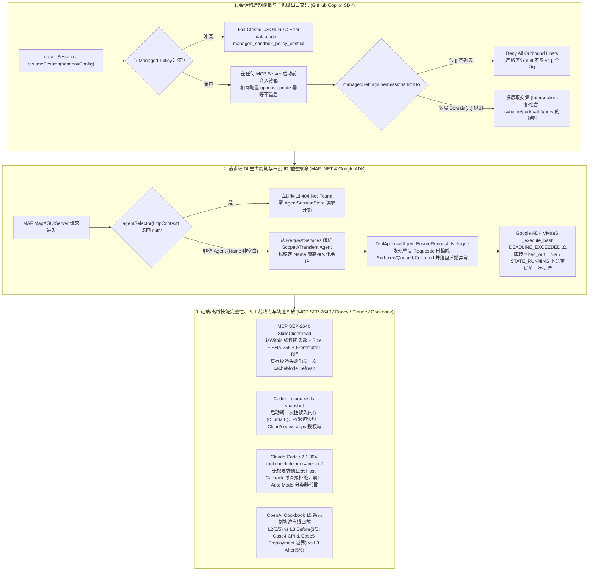

# Agent 沙箱前置围栏、远端技能完整性与录制轨迹回放验收实验室（2026-10-21）

**2026-10-21 范围与执行声明：本包中的 Python 3.11+ 标准库参考契约（`harness_contracts.py`）、OpenAI Cookbook 15 条录制轨迹离线回放数据（`fixtures/cookbook_recorded_traces.json`）与测试套件（`test_harness_contracts.py`）已在本地无网络正常模式（`python3 -B`）与优化模式（`python3 -B -O`）下实际执行，24/24 基线测试 PASS、7/7 定向单点 mutation KILLED；各上游产品宿主运行时（GitHub Copilot CLI/SDK、MAF ASP.NET Core 宿主、Azure MCP Server 二进制、Google ADK VMaaS 远端沙箱、MCP TypeScript SDK 进程、OpenAI Codex App Server / CLI、Anthropic Claude Code CLI）均为 `NOT_RUN`（仅固定 SHA 源码/patch/轨迹静态审阅与本地标准库回放）。**

本资产将三支柱 6 组最新控制面/数据面机制（含 2 项 Backlog 高优积压收口）收敛为一套可复演的无模型离线参考契约、15 条录制轨迹回放对账器、12 张 POC 验收卡、架构边界图与选型问答，供解决方案架构师（SA）在技术答疑、POC 准入验收和架构评审中直接复用。

## 1. 包内配套文件与叶文件哈希

- [标准库参考契约与轨迹回放判分器 `harness_contracts.py`](harness_contracts.py)
- [24 项单测与 7 项变异校准 `test_harness_contracts.py`](test_harness_contracts.py)
- [固定源码溯源清单 `fixtures/provenance.json`](fixtures/provenance.json)
- [OpenAI Cookbook 15 条录制轨迹投影 `fixtures/cookbook_recorded_traces.json`](fixtures/cookbook_recorded_traces.json)
- [离线执行摘要 `run-summary.json`](run-summary.json)
- [包内 SHA256 清单 `SHA256SUMS`](SHA256SUMS)

当前已锁定叶文件 SHA-256（先固定叶文件，再固定本文，最后生成覆盖子目录 6 个文件的 `SHA256SUMS`，避免自引用）：

```text
2d6345808324e4fce3c5d5452a7f01f0e2ea13851808ae8f6cb4a49867349618  harness_contracts.py
bb821aa0919839a5076962435ddc7c92e439651fbd7c8bb7cdad39ec76636413  test_harness_contracts.py
9c31754d49e8600c770ba6816d7d0b88835f8fa344414a7767cac1be1d591f77  fixtures/provenance.json
4685b8f72f579e80abe8fb51dbc9a4c131529e9cee2cc7583dfa5123ffde8db9  fixtures/cookbook_recorded_traces.json
47176b95f9923f3003bec5a21ffe3e73fb88cc6d14d73f0015e3e639e405175d  run-summary.json
```

---

## 2. 固定源码证据与版本/运行边界表

| 来源 ID | 支柱与仓库 | 固定 Revision (40-char SHA) | 核心审阅路径 | 证据层级与运行边界 |
| :--- | :--- | :--- | :--- | :--- |
| `S01_COPILOT_SDK_LIMIT_TO` | 微软 `github/copilot-sdk` | `20d75a718bf40d856525b0c33713c553371af1ab` | `python/copilot/client.py`、`nodejs/src/types.ts`、`nodejs/test/e2e/managed_permissions_limit_to.e2e.test.ts` | 固定 commit `.patch`（HTTP 200）；Backlog 积压升级；Copilot CLI/SDK 实机 `NOT_RUN` |
| `S02_COPILOT_SDK_PRE_MCP_SANDBOX_CONFIG` | 微软 `github/copilot-sdk` | `51e9556d2607f00f9f72038fa16accfe2f5d150d` | `dotnet/src/Client.cs`、`nodejs/src/client.ts`、`docs/mcp/overview.md` | 固定 commit `.patch`（HTTP 200）；对应 `sdk-snapshot/cli-1.0.101`；Copilot CLI/SDK 实机 `NOT_RUN` |
| `S03_MAF_DOTNET_AGUI_SCOPED_LIFETIME` | 微软 `microsoft/agent-framework` | `30bc5c1bd0159f3a96353c9b98a118dc53cc9f6d` | `dotnet/src/Microsoft.Agents.AI.Hosting.AGUI.AspNetCore/AGUIEndpointRouteBuilderExtensions.cs`、`HostedAgentResolution.cs` | 固定 commit `.patch`（HTTP 200）；晚于 `dotnet-1.25.0` tag；ASP.NET Core 实机 `NOT_RUN` |
| `S04_MAF_DOTNET_DUPLICATE_APPROVAL_ID_PURGE` | 微软 `microsoft/agent-framework` | `8ab068b8b360369d6425cc50603eeba07207a9d1` | `dotnet/src/Microsoft.Agents.AI/Harness/ToolApproval/ToolApprovalAgent.cs` | 固定 commit `.patch`（HTTP 200）；晚于 `dotnet-1.25.0` tag；.NET 运行时 `NOT_RUN` |
| `S05_GOOGLE_ADK_VMAAS_SANDBOX_NO_DOUBLE_EXEC` | AI Labs `google/adk-python` | `019b2b21f9b68a344efd6b92f4f7a40a7c6e273b` | `src/google/adk/integrations/vmaas/_agent_engine_environment.py` | 固定 commit `.patch`（HTTP 200，Apache-2.0）；VMaaS 远端沙箱 `NOT_RUN` |
| `S06_MCP_TS_SDK_SEP2640_SKILLS_EXTENSION` | AI Labs `modelcontextprotocol/typescript-sdk` | `46d9c9921b6542e813c1ecc5f9fc964085e8e3bb` | `packages/client/src/ext/skills/skillsClient.ts`、`verify.ts`、`uri.ts` | 固定 commit `.patch`（HTTP 200，MIT）；MCP TS 客户端/服务端 `NOT_RUN` |
| `S07_CODEX_FROZEN_CLOUD_SKILL_SNAPSHOTS` | Coding CLI `openai/codex` | `e776b27eb0422c3d10fba676c632ff08ffb4469b` | `codex-rs/ext/skills/src/provider/frozen_cloud.rs`、`codex-rs/app-server/src/lib.rs` | 固定 commit `.patch`（HTTP 200）；晚于 `rust-v0.163.0` stable；Codex App Server `NOT_RUN` |
| `S08_COOKBOOK_RECORDED_TRACE_REPLAY` | Coding CLI / Eval `openai/openai-cookbook` | `5bd6cb40b6b84b69b2032d810610aa85064102df` | `examples/partners/harness_aware_plugin_evals/data/l2-trace.json`、`l3-trace-before.json`、`l3-trace-after.json`、`eval_grading.py`、`assert_codex_result.py` | 固定源码与 3 份录制轨迹（HTTP 200，MIT）；**15 条录制轨迹已在本地标准库回放验证**；Codex SDK 实机 `NOT_RUN` |
| `S09_CLAUDE_CODE_2_1_304_PERSON_DECIDER` | Coding CLI `anthropics/claude-code` | `772c6bee5c36f58be43bbb2b182862aeb22aceff` | `CHANGELOG.md`（`v2.1.304`）、`mods/sec-default/README.md`（`a6e289a2e772a17b3614a9ef43303003de5cd887`） | 固定 commit `.patch`（HTTP 200）；对应 `v2.1.304` stable/latest；Claude Code CLI `NOT_RUN` |

---

## 3. 核心架构边界图（Mermaid）



---

## 4. 六大机制深度拆解与 SA 客户问答速查

### 4.1 GitHub Copilot SDK：`permissions.limitTo` 闭环主机级出口交集与 MCP 启动前 `sandboxConfig`
- **源码机制（`S01` / `S02`）**：
  1. `[→harness]` `managedSettings.permissions.limitTo` 仅接受主机级表达式 `Domain(hostname)`、`Domain(IP)` 或 `Domain(*.example.com)`，**显式拒绝携带 scheme、port、path、query、fragment 的规则**。多层受管配置（Managed layers）取**交集（Intersection）**。
  2. **关键序列化陷阱（`null` vs `[]`）**：在全语言 SDK（Python/Node/.NET/Go/Java/Rust）中，`limitTo = null`（或省略）表示该层不限制出口主机；而**显式传入空列表 `limitTo: []` 则代表拒绝所有外部主机（denies all hosts）**。
  3. **消除 MCP 启动竞态窗口（`51e9556d`）**：此前先 `createSession` 再调 `session.rpc.options.update({ sandboxConfig })` 会导致根目录/插件 MCP Server 在更新到达前无沙箱启动。现 `createSession` / `resumeSession` 支持前置传入 `sandboxConfig`；若与企业受管策略冲突，直接报错 `data.code = "managed_sandbox_policy_conflict"` 拒绝建连；冷恢复（Cold resume）必须重传 `sandboxConfig`，且相同配置的后续 `options.update` 为幂等操作（不重启已运行的 MCP Server）。
- **SA 问答落点**：金融/政企客户问“如何证明 Copilot SDK 及其拉起的第三方 MCP Server 绝不会在初始化前偷连外网？”，标准架构是：`createSession({ sandboxConfig: { enabled: true, sandboxMcpServers: true } })` + 受管层 `limitTo: ["Domain(*.corp.internal)"]`（或纯离线 `limitTo: []`），并在连接后校验 `ConnectResult.version` 满足最低运行时版本。

### 4.2 MAF .NET：AG-UI Scoped 生命周期修正、请求级选择器 404 短路与重复审批 ID 状态擦除
- **源码机制（`S03` / `S04`）**：
  1. `MapAGUIServer` 此前在路由映射期从根容器解析 `AIAgent`，导致 Scoped/Transient Agent 被捕获为 Singleton。`30bc5c1b` 改为启动期仅用 `IServiceProviderIsKeyedService.IsKeyedService` 验证注册存在，请求期从 `HttpContext.RequestServices` 解析 `AIAgent`、`AgentSessionStore` 与 `AgentIsolationKeyProvider`。
  2. 新增 `MapAGUIServer(pattern, Func<HttpContext, AIAgent?> agentSelector)`：若选择器返回 `null`，**在加载任何 `AgentSessionStore` 之前立即返回 HTTP 404**；若返回非空 Agent，则强制校验 `agent.Name` 非空白，并以 `agent.Name` 作为稳定的 `sessionStorageIdentity`。
  3. `[→harness]` `ToolApprovalAgent.EnsureRequestIdsUnique`（`8ab068b8`）推翻了“模型生成的 ToolCall ID 天然唯一”的假设：当同一批次或跨流式分片出现重复 `RequestId` 时，不仅抛出 `InvalidOperationException`，而且在抛出前**主动从 `SurfacedApprovalRequests`、`QueuedApprovalRequests`、`CollectedApprovalResponses` 中擦除所有冲突 ID 并调用 `SaveState` 持久化**，防止残留的同名审批在下一轮被用于放行高危工具。
  4. 同批次 `f7c6928a` 为 `AgentFileStore.SearchAsync` 增加 10 秒总超时预算（`MultiStepOperationTimeout`），`bb4a7433` 为声明式 MCP 调用 Header 增加 `HttpHeaderValidation.ValidateNoProhibitedCharacters` 防 CRLF 注入。

### 4.3 Google ADK Python：VMaaS 沙箱超时识别与防非幂等命令二次执行
- **源码机制（`S05`）**：
  1. `[→harness]` 远端 VMaaS 沙箱因超时终止命令时，底层 API 返回 `FAILED_PRECONDITION` 且错误消息包含 `"DEADLINE_EXCEEDED"`（而非 HTTP 504）。旧版 `_execute_bash` 将所有 `FAILED_PRECONDITION` 当作“沙箱已暂停”，调用 `wait_until_running` 后把同一条非幂等 Bash 命令重跑第二遍。
  2. `019b2b21` 修复后：`_is_timeout` 检查 `code == 504`、`status == "DEADLINE_EXCEEDED"` 或 `"DEADLINE_EXCEEDED" in message`，命中后立即返回 `ExecutionResult(exit_code=-1, timed_out=True)`；对于其他 `503`/`FAILED_PRECONDITION`，先查询 `get_sandbox_state`，若沙箱已处于 `STATE_RUNNING`（或本轮已 `resumed = True`），直接原样抛出异常，**绝不二次重发已到达运行中沙箱的命令**；仅当 `_is_unreachable`（`"Unable to reach the sandbox environment"`，证明命令未送达 Shell Server）时才在 60 秒窗口内安全重试。

### 4.4 MCP 官方 TypeScript SDK `SEP-2640` 远端技能扩展与 Codex 冻结云端技能快照
- **源码机制（`S06` / `S07`）**：
  1. `[→harness]` `modelcontextprotocol/typescript-sdk`（`46d9c992`）正式落地 `SEP-2640` Skills 扩展（`skills/list`、`skills/get`、`resources/directory/read`）。客户端 `SkillsClient.read` 执行四道防投毒门禁：① `isWithin(rootUri, uri)` 对每个路径段做 URL 解码后拦截 `""`、`"."`、`".."`、`"/"`、`""`，并用线性循环 `trimTrailingSlashes` 替代正则 `/\/+$/` 消除超长斜杠序列 ReDoS；② 非 `"dynamic"` 技能在发请求前强制核对目标文件是否在 `skill.resources` 清单中（否则抛 `SkillVerificationError('unlisted')`）；③ 校验返回字节长度与 `listed.size`、SHA-256 与 `listed.digest` 完全一致；④ 对 `SKILL.md` 解析 YAML 头并调用 `frontmatterDifferences(skill.frontmatter, frontmatter)` 做双向递归比对，防止服务端列表声明的元数据与实际下发的 Markdown 头不一致。若命中客户端响应缓存（`cached === true`）的副本校验失败，自动以 `cacheMode: 'refresh'` 重拉一次。
  2. `[→harness]` OpenAI Codex `e776b27e` 在 App Server 新增 `--cloud-skills-snapshot PATH`（`FrozenCloudSkillProvider`）：启动期一次性将 JSON 快照（上限 `64 MiB`，`#[serde(deny_unknown_fields)]`）读入内存，后续 `skills.list`/`skills.read` 完全脱离文件系统与实时 MCP 网络；构造期强制校验 `alias_root` 以 `skill://` 开头、`package` 位于 `alias_root` 内、`main_resource` 存在、所有资源路径严格位于 `package` 内部且不超过单资源字节上限、无重复包名；读取期强制校验调用方 Authority 必须等于 `(SkillSourceKind::Cloud, "codex_apps")`。

### 4.5 OpenAI Codex 并发登录代数围栏与 Claude Code `v2.1.304` `decider: "person"` 强制人工/宿主裁决门
- **源码机制（`S09` & Codex `c6e4438a`）**：
  1. `[→harness]` Codex `c6e4438a` 在 `AuthManager` 引入 `AuthChangeState { generation, owner_generation }`：即使当前缓存已为空，`logout()` 仍递增 `generation` 以围栏拦截在登出前发起的在途磁盘重载（`publish_reloaded_auth`）；刷新 Token 落盘时校验存储中的 `login_owner_id` 是否与发起刷新时的登录一致（若旧版本客户端抹掉了 `login_owner_id`，则仅在 `refresh_token` 仍匹配时允许更新），防止跨账号覆盖凭据。
  2. `[→harness]` Claude Code `v2.1.304`（`772c6bee`）为 Mod 的 `tool.check` 响应新增 `decider: "person"` 与只读属性 `e.isReadOnly`：当 Mod 返回 `ask` 且指定 `decider: "person"` 时，**只有交互式权限对话框或宿主应用（Host SDK）的权限回调可以批准该请求**，严禁客户端/服务端 Auto Mode 分类器自动放行；在无人值守（Headless / Scheduled / 无回调）环境下直接以 Mod 给出的 `reason` 拒绝执行。同时修复了插件在 `--max-turns` 或 `Stop` 后通过派发子 Agent 继续续命的绕过漏洞。
  3. `[→harness]` Claude Code `mods/sec-default/README.md`（`a6e289a2`）显式披露了一个关键边界：`sec-default` 虽然保护了已加载的受管 `CLAUDE.md` 不被用户插件改写，但**不拦截关闭 `CLAUDE.md` 加载的环境变量**——如果用户设置或插件注入了 `CLAUDE_CODE_DISABLE_CLAUDE_MDS`、`CLAUDE_CODE_SIMPLE` 或 `CLAUDE_CODE_SAFE_MODE`，包括组织级受管 `CLAUDE.md` 在内的所有指令文件都不会加载！企业宿主必须在启动容器/进程前在外层清洗或锁定这 3 个环境变量。

### 4.6 OpenAI Cookbook `harness_aware_plugin_evals`：15 条录制轨迹离线回放对账（销 Backlog 优先项）
- **源码与录制轨迹对账（`S08`）**：
  1. `[→harness]` 本包提取了上游 `5bd6cb40` 中 `data/l2-trace.json`（5 条 Standalone 工具循环轨迹）、`data/l3-trace-before.json`（5 条无 MCP instructions 的真实 Codex Harness 轨迹）与 `data/l3-trace-after.json`（5 条注入 MCP `initialize.instructions` 后的真实 Codex Harness 轨迹）的完整工具调用与判分字段，并用纯标准库复刻了 `eval_grading.py` + `assert_codex_result.py` + `assert_result.py`。
  2. **为什么 L3 Before 在 Case 4（CPI）与 Case 5（Employment）失败？**
     - 这两道题属于**歧义指标查询**，标准答案要求 `expected_tools = "resolve"`、`expected_series_ids = ""`（即只允许调用 `resolve` 查出候选序列并向用户追问澄清，**禁止擅自调用 `fetch_bls_data` 拉取数据**）。
     - 在 **L2 Standalone Loop** 中，测试脚本的系统提示词较为简单，模型在 `resolve` 后停下追问，5/5 全部通过。
     - 在 **L3 Before（真实 Codex Harness）** 中，Codex 内置的系统提示词强烈鼓励 Agent “自主完成端到端任务、减少中途停顿打扰用户”：导致模型在 **Case 4（CPI）** 中连调 6 次 `resolve` 未果后，凭训练记忆强行调用 `fetch_bls_data(series_ids=['CUUR0000SA0'])`（服务端返回 `error`），触发 `unexpected_series = ['CUUR0000SA0']` 判 0 分；在 **Case 5（U.S. employment）** 中，`resolve` 返回多个高分候选后，模型不等用户确认便直接调用 `fetch_bls_data(series_ids=['LNS12000000', 'CES0000000001'])`，触发 `unexpected_series = ['CES0000000001', 'LNS12000000']` 判 0 分！
     - 在 **L3 After** 中，通过在 MCP Server 的 `initialize` 握手响应中注入领域级 `instructions`（明确要求遇到模糊指标或 `resolve` 无精确匹配时必须停止并请求澄清，严禁猜测序列号），Codex 在 Case 4 和 Case 5 中均只调用 1 次 `resolve` 即停下追问，恢复 5/5 满分。

---

## 5. 12 张可复用 POC 验收与回归卡（Expected vs Observed）

> **状态约定**：`Reference_Lab_Observed` 为本包 Python 3.11+ 标准库参考契约与 15 条录制轨迹回放的实测结果；`Upstream_Host_Observed` 为对应上游产品宿主/CLI 的实测状态（当前全部为 `NOT_RUN`）。

| 卡号 | 目标机制与来源 ID | 前置条件 (Precondition) | 激励 / 故障注入 (Stimulus) | 期望结果 (Expected) | 独立负控 / 变异靶点 (Negative Control) | Reference_Lab_Observed | Upstream_Host_Observed |
| :--- | :--- | :--- | :--- | :--- | :--- | :--- | :--- |
| `C01` | Copilot SDK `limitTo` 语法与空数组全拒 (`S01`) | 配置多层 `managedSettings.permissions.limitTo` | （a）传入含 `https://`、`:443`、`/path` 的规则；（b）传入 `[None, []]` 或多层 `Domain(...)` | （a）立即抛 `ValueError`；（b）`[]` 拒绝所有外部主机，非空多层取严格交集 | `M1_copilot_empty_limit_to_allows_all`（将 `[]` 视为无限制） | `PASS` / `M1 KILLED` (`test_01`, `test_02`) | `NOT_RUN` |
| `C02` | Copilot SDK MCP 启动前 `sandboxConfig` (`S02`) | 调用 `createSession` / `resumeSession` / `options.update` | （a）与受管策略冲突；（b）冷恢复省略 `sandboxConfig` vs 驻留恢复省略；（c）相同配置 `update` | （a）报 `managed_sandbox_policy_conflict`；（b）冷恢复失守、驻留保留；（c）不重启 MCP | 冲突时静默降级为无沙箱会话 | `PASS` (`test_03`, `test_04`) | `NOT_RUN` |
| `C03` | MAF .NET AG-UI Scoped 生命周期与 404 短路 (`S03`) | 注册 Scoped/Singleton Agent 或 `agentSelector` | 连续发起 2 次请求；对 `agentSelector` 传入未知路由返回 `null` 或空白 `Name` | Scoped 每次请求新建实例但共享稳定 `Name` 分区；`null` 立即返 404 且 `store_load_calls == 0` | 在 `agentSelector` 判空前提前加载 `AgentSessionStore` | `PASS` (`test_05`, `test_06`) | `NOT_RUN` |
| `C04` | MAF .NET 重复审批 `RequestId` 状态擦除 (`S04`) | `ToolApprovalState` 已存 `call-dup` 的 Surfaced/Queued/Collected 记录 | 流式或同批收到重复 `call-dup` 审批请求 | 抛 `InvalidOperationException`，且将 `call-dup` 从三处状态集合彻底擦除并 `SaveState` | `M2_maf_duplicate_approval_skips_state_purge` | `PASS` / `M2 KILLED` (`test_07`, `test_08`) | `NOT_RUN` |
| `C05` | Google ADK VMaaS 超时与运行态禁重放 (`S05`) | 沙箱处于 `STATE_RUNNING` 执行非幂等命令 | 返回 `FAILED_PRECONDITION`（含或不含 `DEADLINE_EXCEEDED`） | 含 `DEADLINE_EXCEEDED` 返 `timed_out=True, exit_code=-1`；不含则原样抛错，均严禁二次执行 (`attempts == 1`) | `M3_adk_vmaas_retries_running_failed_precondition` | `PASS` / `M3 KILLED` (`test_09`, `test_10`) | `NOT_RUN` |
| `C06` | Google ADK VMaaS 暂停恢复与不可达重试 (`S05`) | 沙箱处于 `STATE_PAUSED`，恢复初期返回 `Unable to reach the sandbox environment` | 发起命令 -> 触发一次 `wait_until_running` -> 不可达重试 -> 成功 | `resume_calls == 1`，不可达阶段安全重试，送达 Shell 后返回 `exit_code=0` | 将 `resumed=True` 后的 `FAILED_PRECONDITION` 再次 resume | `PASS` (`test_11`) | `NOT_RUN` |
| `C07` | MCP `SEP-2640` 路径防逃逸与三重完整性校验 (`S06`) | 客户端持有 `skills/list` 条目（含 `size`、`digest`、`frontmatter`） | 请求 `../`、`%2e%2e`、未声明文件，或返回篡改了 YAML `frontmatter` 的 `SKILL.md` | 路径逃逸与未列文件抛 `unlisted`；YAML 头不一致抛 `SkillVerificationError('frontmatter')` | `M4_mcp_skills_skip_frontmatter_diff` | `PASS` / `M4 KILLED` (`test_12`, `test_13`) | `NOT_RUN` |
| `C08` | MCP `SEP-2640` 缓存污染自动 `refresh` (`S06`) | 本地响应缓存（`cached=True`）中的 `SKILL.md` 字节损坏 | 调用 `SkillsClient.read` | 首次校验失败后自动以 `cacheMode='refresh'` 重拉一次并通过验证 | 缓存失败不重拉或无限循环重拉 | `PASS` (`test_14`) | `NOT_RUN` |
| `C09` | Codex `--cloud-skills-snapshot` 冻结快照边界 (`S07`) | 启动期加载 JSON 快照（含 `prompt_visible=False` 技能） | （a）使用 `Executor` Authority 读取；（b）快照内资源 URI 跨包越界 `skill://other/secret.md` | （a）抛 `PermissionError`；（b）启动期抛 `ValueError` 拒绝加载快照 | `M5_codex_frozen_skill_allows_cross_package_resource` | `PASS` / `M5 KILLED` (`test_15`) | `NOT_RUN` |
| `C10` | Codex 并发登录/登出代数围栏 (`S07`/Codex `c6e4438a`) | 缓存为空时执行 `logout()`，或在途 Token 刷新跨越账号切换 `user-a -> user-b` | 旧代数的 `publish_reloaded_auth` 到达，或 `user-a` 的刷新结果尝试落盘 | 均返回 `False` 拒绝覆盖当前状态；旧客户端抹除 `login_owner_id` 但 `refresh_token` 匹配时允许更新 | 空缓存 `logout()` 不递增 `generation` | `PASS` (`test_16`) | `NOT_RUN` |
| `C11` | Claude `v2.1.304` `decider: "person"` 与环境变量边界 (`S09`) | Mod `tool.check` 返回 `ask` + `decider: "person"`；Auto Mode 分类器返回批准 | 在无交互弹窗且无 Host Callback 的 Headless 环境运行；同时检测 `CLAUDE_CODE_DISABLE_CLAUDE_MDS` | 忽略 Auto Mode 分类器直接 `deny` 并保留 Mod 理由；标记关闭 `CLAUDE.md` 的环境变量风险 | `M7_claude_person_decider_allows_auto_classifier` | `PASS` / `M7 KILLED` (`test_17`) | `NOT_RUN` |
| `C12` | Cookbook 15 条录制轨迹回放与越界序列拦截 (`S08`) | 加载 `l2_standalone` (5条)、`l3_codex_before` (5条)、`l3_codex_after` (5条) 固定轨迹 | 执行离线回放判分，并注入损坏 JSON / 失败 MCP item 负例 | L2 5/5 PASS；L3-Before 3/5（Case 4 `CUUR0000SA0` 与 Case 5 `CES0000000001, LNS12000000` 因 `unexpected_series` FAIL）；L3-After 5/5 PASS | `M6_cookbook_grader_ignores_unexpected_series` | `PASS` / `M6 KILLED` (`test_18`–`test_24`) | `NOT_RUN` |

---

## 6. 离线复现命令（无需网络、无需模型密钥）

在包含本资产包的目录下直接运行标准库测试、15 条录制轨迹回放与 7 项变异校准：

```sh
python3 -B test_harness_contracts.py
python3 -B -O test_harness_contracts.py
```
